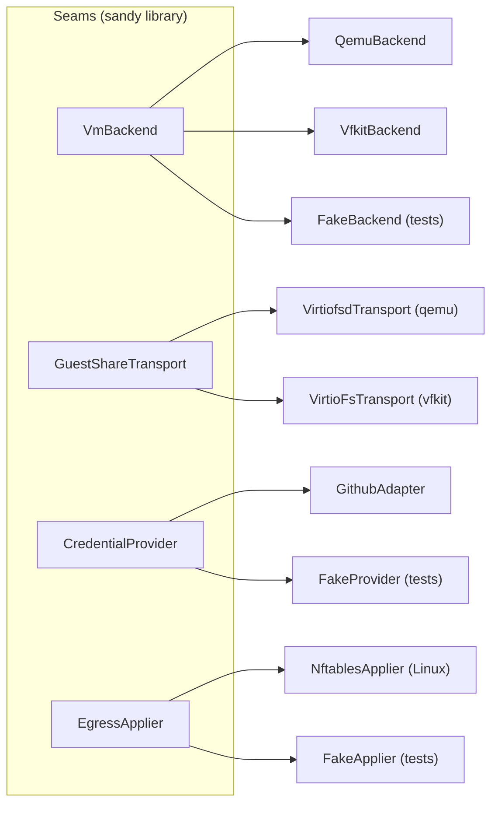

# sandy

[](https://github.com/kauki-labs/sandy/actions/workflows/pr.yaml)
[](https://crates.io/crates/sandy-lib)
[](https://docs.rs/sandy-lib)
[](https://codecov.io/gh/kauki-labs/sandy)
[](LICENSE)
[](rust-toolchain.toml)

sandy runs a job in an ephemeral NixOS microVM and returns a locked result
envelope. One `VmBackend` seam launches the guest (qemu on Linux, vfkit on
macOS); inputs, outputs, secrets, and a scoped forge credential travel in over
virtio-fs shares; an egress allow-list wraps the boot.

A job boots a real microVM and runs end to end on both backends, verified by
host-gated live tests on Linux/KVM and Apple-silicon hosts.

## Seams

Every hard boundary behind the library is a trait with one implementation per
target — the extension points a new backend, transport, credential provider,
or egress applier plugs into.



The run pipeline, each subsystem's design, and the live acceptance matrix are
in [`docs/architecture/`](docs/architecture/overview.md).

## Usage

```sh
sandy doctor                       # verify host prerequisites
sandy run <template> [flags] -- <cmd...>
```

`<template>` is a guest flake attr (e.g. `topologies.aarch64-linux.vfkit`). The
job command runs inside the guest; its exit code and the guest console come back in
the result envelope. Flags (repeatable where it makes sense):

| Flag                                       | Effect                                                                                                           |
| ------------------------------------------ | ---------------------------------------------------------------------------------------------------------------- |
| `--input HOST:NAME`                        | mount the host file/dir read-only at `/run/sandy/inputs/NAME` (write → `EROFS`)                                  |
| `--out DEST` / `--out NAME:DEST`           | collect everything under `/run/sandy/outputs` (or just `/run/sandy/outputs/NAME`) to the host `DEST` at teardown |
| `--secret NAME=@PATH`                      | inject the file's bytes as `$NAME` in-guest (never on argv/env)                                                  |
| `--env KEY=VALUE`                          | set an environment variable in-guest                                                                             |
| `--credential <name>`                      | mint a scoped token from a `sandy cred github` trust root, inject it as `$GITHUB_TOKEN`, revoke at teardown      |
| `--allow HOST:PORT`                        | egress allow-list entry (enforced on Linux; macOS is unfiltered)                                                 |
| `--cpu N` / `--mem MiB` / `--timeout SECS` | resource knobs                                                                                                   |
| `-o plain` (default) / `-o json`           | human summary, or the full structured envelope for agents                                                        |

```sh
# read an input, write a collected output, with a scoped GitHub token
sandy run topologies.aarch64-linux.vfkit \
  --input ./data:data --out result:./out --credential sandy-runner \
  -- sh -c 'process /run/sandy/inputs/data > /run/sandy/outputs/result/report'
```

Running jobs are managed with `sandy ls` / `status` / `wait` / `kill` / `gc`.
Credential trust roots are managed with
`sandy cred github register | import | verify | deregister` (see
[`docs/providers/github`](docs/providers/github/README.md)). `sandy daemon
submit | status | attach | cancel | list` drives `sandyd`, an evolving
control-plane daemon with its own job model (see
[`docs/decisions/sandyd.md`](docs/decisions/sandyd.md)).

## Development

Build, test, and contribution workflow are in [`AGENTS.md`](AGENTS.md) — the
canonical source Claude Code and GitHub Copilot both read natively. Full
architecture, design decisions, and subsystem specs are under
[`docs/`](docs/overview.md).

## License

MIT — see [LICENSE](LICENSE).
