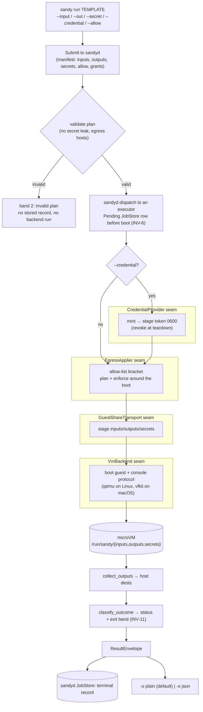
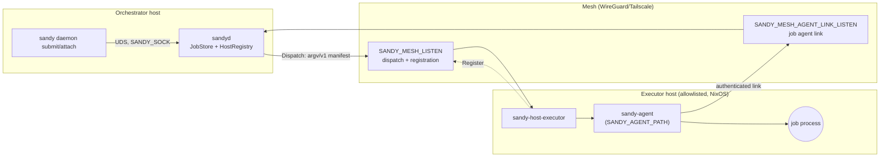

# sandy

[](https://github.com/kauki-labs/sandy/actions/workflows/pr.yaml)
[](https://crates.io/crates/sandy-lib)
[](https://docs.rs/sandy-lib)
[](https://codecov.io/gh/kauki-labs/sandy)
[](LICENSE)
[](rust-toolchain.toml)

[](https://codecov.io/gh/kauki-labs/sandy)

`sandy` runs a job in an ephemeral NixOS microVM and returns a locked result
envelope. One `VmBackend` seam launches the guest (qemu on Linux, vfkit on
macOS); inputs, outputs, secrets, and a scoped forge credential travel in over
virtio-fs shares; an egress allow-list wraps the boot.

A job boots a real microVM and runs end to end on both backends, verified by
host-gated live tests on Linux/KVM and Apple-silicon hosts.

## Architecture

One `sandy run` is a straight-line pipeline. Every hard boundary in it — a
backend, a transport, a credential provider, an egress applier — is a seam: a
trait with one implementation per target, shown below as the boundary around
the step it owns.



Each seam's concrete implementations (`QemuBackend`/`VfkitBackend`,
`VirtiofsdTransport`/`VirtioFsTransport`, `GithubAdapter`,
`NftablesApplier`), the full subsystem design, and the live acceptance matrix
are in [`docs/architecture/`](docs/architecture/overview.md).

## Usage

```sh
sandy doctor                       # verify host prerequisites, sandyd and an executor
sandy run <template> [flags] -- <cmd...>
```

`sandy run` submits the job to `sandyd` and waits for it, so it needs a running `sandyd`
(socket `$SANDY_SOCK`) and a `sandy-host-executor` that can boot a VM: two processes, see
[Running `sandyd` across multiple hosts](#running-sandyd-across-multiple-hosts) (one
machine works too). A VM job is untrusted: only a hypervisor boundary may run it.

`<template>` is `topologies.<system>.<hypervisor>` of sandy's bundled guest flake, or
`REF#topologies.<system>.<hypervisor>` for your own flake `REF`. The executor picks
its own system and hypervisor. It evaluates the topology but does not build it: on a
cold executor build the guest runner of the topology you submit first (for sandy's
own: `nix build ./nix/guest#packages.<system>.guest-runner`, qemu; `guest-runner-vfkit`
on macOS). The job command runs inside the guest; its exit code
and the guest console come back in the result envelope. Flags (repeatable where it
makes sense):

| Flag                                       | Effect                                                                                                           |
| ------------------------------------------ | ---------------------------------------------------------------------------------------------------------------- |
| `--input HOST:NAME`                        | mount the host file/dir read-only at `/run/sandy/inputs/NAME` (write → `EROFS`)                                  |
| `--out DEST` / `--out NAME:DEST`           | collect everything under `/run/sandy/outputs` (or just `/run/sandy/outputs/NAME`) to the host `DEST` at teardown |
| `--secret NAME=@PATH`                      | inject the file's bytes as `$NAME` in-guest (never on argv/env)                                                  |
| `--env KEY=VALUE`                          | set an environment variable in-guest                                                                             |
| `--credential <name>`                      | mint a scoped token from a `sandy cred github` trust root, inject it as `$GITHUB_TOKEN`, revoke at teardown      |
| `--allow HOST:PORT`                        | egress allow-list entry (enforced on Linux; macOS has no guest NIC, so nothing to filter)                        |
| `--cpu N` / `--mem MiB` / `--timeout SECS` | resource knobs                                                                                                   |
| `-o plain` (default) / `-o json`           | human summary, or the full structured envelope for agents                                                        |

```sh
# read an input, write a collected output, with a scoped GitHub token
sandy run topologies.aarch64-linux.vfkit \
  --input ./data:data --out result:./out --credential sandy-runner \
  -- sh -c 'process /run/sandy/inputs/data > /run/sandy/outputs/result/report'
```

```sh
sandy ls                       # list every job sandyd knows
sandy status <job-id>          # print one job's current state
sandy wait <job-id>            # block until terminal, then print it; exit by band
sandy kill <job-id>            # cancel a job and tear its box down
sandy gc [--keep-last N]       # delete terminal jobs, keep the newest N (default 20)
```

Credential trust roots are managed with
`sandy cred github register | import | verify | deregister` (see
[`docs/providers/github`](docs/providers/github/README.md)).

```sh
sandy daemon submit <manifest|-> --manifest-encoding <ENCODING> --isolation-class <trusted|untrusted>
sandy daemon status|attach|cancel <job-id>
sandy daemon list
```

`sandy daemon` makes the same control-RPC calls as the verbs above and adds
`submit` without `--wait`, `attach`, and the manifest and isolation-class flags
(see [`docs/decisions/sandyd.md`](docs/decisions/sandyd.md)).

### Running `sandyd` across multiple hosts

`sandyd` can dispatch a job to a remote `sandy-host-executor` over a mesh
(WireGuard/Tailscale) instead of running everything locally. The orchestrator
runs anywhere (macOS or Linux); the executor is NixOS-specific (its
trusted-process sandbox is `bwrap` + `systemd-run --user`). All of `sandyd`'s
config is environment variables, no CLI flags:



Full operational detail (placement, the isolation-class re-check, the attach
relay, transcript archival) is the control-plane diagram in
[`docs/architecture/overview.md`](docs/architecture/overview.md#the-control-plane-sandyd-the-host-executor-interactive-attach).

```sh
# orchestrator host
SANDY_SOCK=/tmp/sandyd.sock \
SANDY_MESH_LISTEN=<orchestrator-ip>:4000 SANDY_MESH_ALLOWLIST=<executor-ip> \
SANDY_MESH_AGENT_LINK_LISTEN=<orchestrator-ip>:4001 \
sandyd

# executor host — SANDY_AGENT_PATH must resolve outside /tmp (the trusted-
# process backend's bwrap sandbox replaces /tmp with an empty tmpfs)
SANDY_AGENT_PATH="$(nix build .#sandy-agent --no-link --print-out-paths)/bin/sandy-agent" \
SANDY_HOST_EXECUTOR_ORCHESTRATOR=<orchestrator-ip>:4000 \
SANDY_HOST_EXECUTOR_ID=<any-name> \
sandy-host-executor

# from the orchestrator host: submit an argv/v1 manifest (a JSON array of argv), then attach
SANDY_SOCK=/tmp/sandyd.sock sandy daemon submit manifest.json --manifest-encoding argv/v1 --isolation-class trusted -o json
SANDY_SOCK=/tmp/sandyd.sock sandy daemon attach <job-id>
```

`--flake` submissions dispatch as a VM job instead (sandbox kind `Vm`, #332),
which needs both `SANDY_MESH_AGENT_LINK_LISTEN` configured and a registered
host that declares VM capability — `sandyd` refuses the submission when
either is missing. The same `sandy-host-executor` also registers `Vm` when
its own VM probes succeed (e.g. KVM present), so whether it can run
`--flake` jobs depends on that probe, not on which dispatch path you use;
this `argv/v1` path exercises the trusted-process executor specifically.
Full walkthrough, the allowlist/bind-address constraints, and the
`SANDY_AGENT_PATH` gotcha above:
[`docs/design/host-executor/spec.md`](docs/design/host-executor/spec.md#manual-cross-machine-smoke-test).

## Development

Build, test, and contribution workflow are in [`AGENTS.md`](AGENTS.md) — the
canonical source Claude Code and GitHub Copilot both read natively. Full
architecture, design decisions, and subsystem specs are under
[`docs/`](docs/overview.md).

### direnv (optional)

With [direnv](https://direnv.net/) installed, `direnv allow` in the repo root
loads the Nix dev shell and pre-commit hooks automatically on `cd`, so you
don't need to run `nix develop` by hand each time. Without it, use `nix
develop` directly as shown in [`AGENTS.md`'s Setup](AGENTS.md#setup).

## License

Sandy is dual-licensed:

- **Open source:** [GNU AGPL-3.0-only](LICENSE). Free to use, modify, and distribute under the AGPL's terms, including its network-use copyleft (a service built on Sandy must offer its complete corresponding source).
- **Commercial:** a separate commercial license is available for use that cannot meet the AGPL's obligations, such as proprietary or closed-source products and services. See [COMMERCIAL.md](COMMERCIAL.md).

Contributions are accepted under the Contributor License Agreement in [CONTRIBUTING.md](CONTRIBUTING.md), which lets the project offer the commercial license above.
