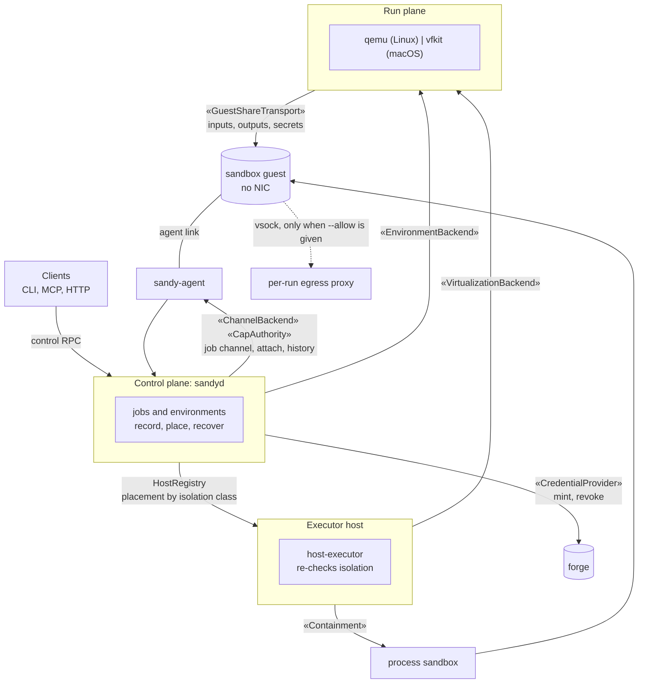
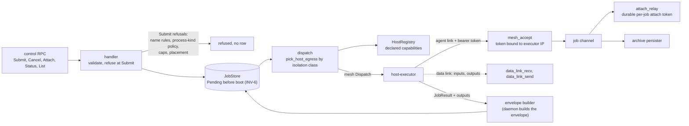
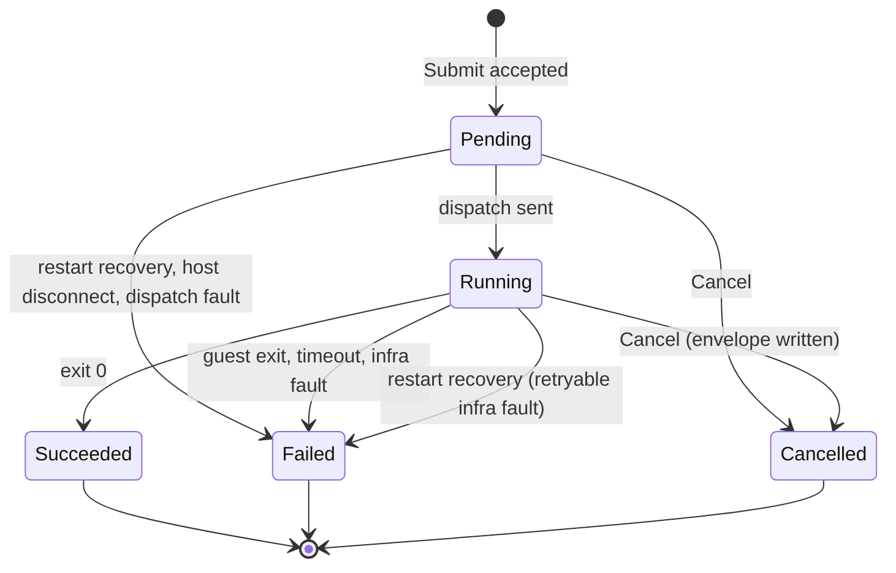
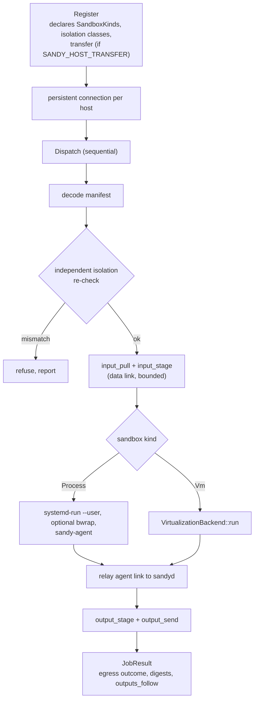
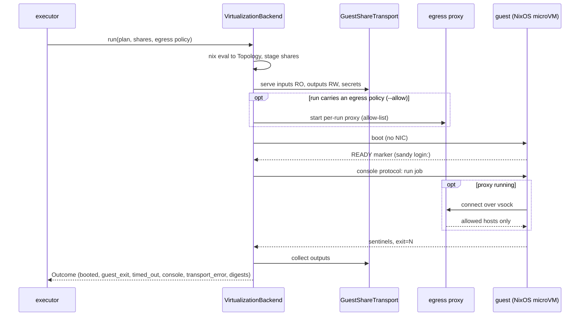
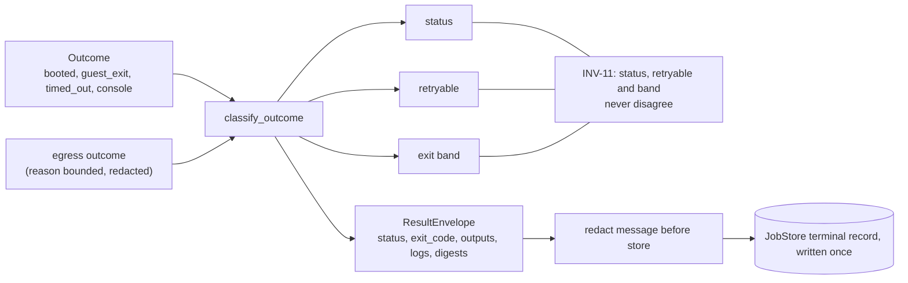
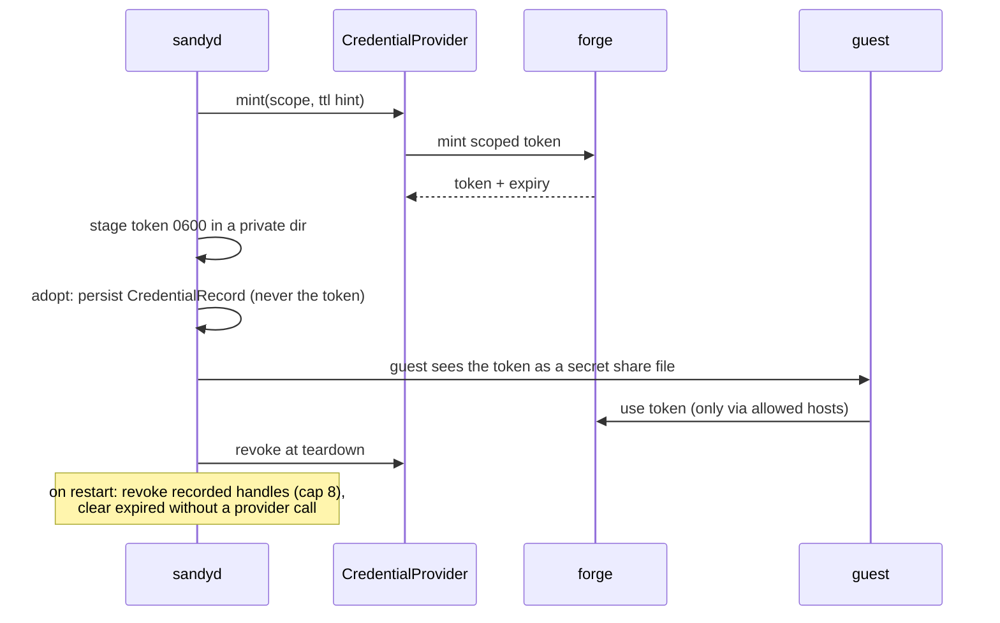
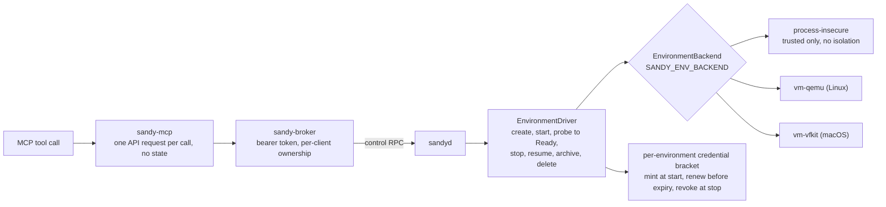

# sandy architecture: components (level 2)

The whole system in one picture, then one schematic per component. Read
[`overview.md`](overview.md) first for the run pipeline and the seam list. This
page shows where each seam sits, which process owns what, and how each
component is meant to behave. Decisions and their tests are in
[`spec.md`](spec.md) and [`../decisions/`](../decisions).

Every box is a crate or a process. Most `«seam»` labels are traits with a real
implementation and a fake for tests (the table in section 2 says which do not). The direct execution path no
longer exists (#483): every job goes through `sandyd`.

## 1. The whole system

Reading it: a client talks only to `sandyd`. `sandyd` records and places the
job; an executor runs it through `VirtualizationBackend` or the process sandbox; the guest
has no network unless the run carries an allow-list, and then only through the
per-run egress proxy; its agent link returns to `sandyd`. Sections 3 to 8 open each box.

## 2. Seams and their implementations

| Seam                                 | Trait home     | Real impls                                                              | Fakes (tests)                    |
| ------------------------------------ | -------------- | ----------------------------------------------------------------------- | -------------------------------- |
| `VirtualizationBackend`              | `sandy-api`    | `QemuBackend`, `VfkitBackend`, process backend                          | `FakeBackend`                    |
| `GuestShareTransport`                | `sandy-api`    | virtiofsd (qemu), virtio-fs (vfkit), local dir (process)                | contract fixtures in `sandy-api` |
| `CredentialProvider`                 | `sandy-api`    | GitHub adapter                                                          | `FakeProvider`                   |
| `EnvironmentBackend`                 | `sandy-api`    | `ProcessEnvironmentBackend`, `VmEnvironmentBackend`                     | in-memory                        |
| `Containment`                        | `sandy-api`    | host containment (cgroup reaping)                                       | `FakeContainment`                |
| `Discovery` (nix builder matrix)     | `sandy-api`    | `sandy::StaticRegistry`                                                 | none                             |
| `Executor`                           | `sandy-fabric` | `VirtualizationBackendExecutor` (fabric-local, not wired into `sandyd`) | contract-test harness            |
| `ChannelBackend`                     | `sandy-fabric` | in-memory local channel                                                 | contract-test harness            |
| `CapAuthority`                       | `sandy-fabric` | `LocalCapAuthority`                                                     | contract-test harness            |
| `Minter`                             | `sandy-fabric` | `LocalMinter`                                                           | contract-test harness            |
| `Transport`                          | `sandy-fabric` | none                                                                    | contract-test harness            |
| `Discovery`, `Capacity`, `Lifecycle` | `sandy-fabric` | fabric-local placement (not used by `sandyd`)                           | contract-test harness            |
| `TelemetrySink`, `EscalationSink`    | `sandy-fabric` | local sink (operator sink pending, #850)                                | contract-test harness            |
| `Dialer`, `Conn`                     | `sandy-conn`   | `UnixDialer` (vfkit), `VsockDialer` (qemu), UDS                         | in-process pair                  |
| `EgressApplier`                      | `sandy-api`    | none in production after the NIC removal (#865)                         | `FakeApplier`                    |

`sandyd` places jobs with its own `HostRegistry`, not the fabric `Executor`,
`Discovery`, `Capacity` or `Lifecycle` traits. Those fabric traits and their local
implementations are exercised by the fabric-compose acceptance tests and are not
on the production dispatch path. `sandyd` does use `ChannelBackend` and
`CapAuthority` for the job channel.

A seam never grows a second meaning to suit one caller. A change to a trait
updates its spec section, its decision record and its row in
[`kpi.md`](kpi.md).

## 3. Control plane: `sandyd`

One daemon per machine owns job state. The CLI and the broker are thin: they
send control RPCs over a Unix socket (mode 0600, in a 0700 directory) and render the reply.

Job lifecycle, as the store records it:

How it should behave:

- **Refuse early.** A bad name, a process-kind policy or a field over its cap is
  refused at `Submit` and leaves no row. So is a job that must be placed but
  cannot be: one that needs a VM, is untrusted, names path or secret fields, a
  credential, an egress policy or digests, with no capable host.
- **Write before boot.** The `Pending` row exists before any executor sees the
  job (INV-6, as `spec.md` section 7 states it; the definition at the top of
  `spec.md` still says a `Running` record). A crash can strand a row but never lose one.
- **Recover before serving.** At start, `Pending` and `Running` rows become
  `Failed` with a retryable infra-fault envelope before the socket accepts a
  call. Credential records are read before serving. The revokes then run in the
  background in batches of 8, each under the 45 s daemon call timeout; an
  expired record is cleared with no provider call and a failed revoke keeps the
  record.
- **A plain trusted process job with no host stays `Pending`.** No local
  fallback (#292). This is today's behaviour; #868 proposes failing it instead.

## 4. Host executor

The executor trusts nothing it is sent. It re-checks the isolation class
before it runs anything (defense in depth) and declares only what it can do. A
host without containment refuses to start on Linux. The VM arm declares `Vm`
only where a hypervisor exists (qemu on Linux, vfkit on macOS).

## 5. Run plane: one VM boot

How it should behave:

- **No NIC.** The guest has no network device. With no `--allow` it has no
  network at all. With `--allow`, its only path out is vsock to the per-run
  proxy, which allows listed hosts and filters addresses. `--allow` is the only
  egress input (#483).
- **Secrets stay off the data plane** (INV-1): `$NAME` values come through the
  secrets share, never argv, env or the store.
- **Read-only means read-only at the host boundary.** Inputs are mounted RO by
  the transport, not by guest cooperation.
- **Liveness only through `VirtualizationBackend::boxes`** (INV-3), so gc and recovery never
  guess from a pid.

## 6. Result and classification

The envelope is locked: its shape is the contract callers script against. A
cancel writes an envelope too. The terminal record is written once, after
redaction (#322).

## 7. Credentials

Fail-closed: a failed mint refuses the job (INV-7). A failed revoke keeps the
record so the next start retries it. The token is never written to a log.

## 8. Environments, broker and MCP

An environment is a long-lived service (for example a dev server) beside the
job resource. The broker exposes both to HTTP clients and MCP tools.

The driver is level-triggered: it converges the boxes a backend runs to the
rows, fails a row on a failed probe or timeout, and kills any box no live row
names. After a restart it is the reconciler.

## 9. Where to read next

- Pipeline and subsystem map: [`overview.md`](overview.md)
- Per-subsystem decisions and tests: [`spec.md`](spec.md)
- Live acceptance matrix, including rows not yet re-proven through the daemon
  (#858): [`kpi.md`](kpi.md)
- Why: [`../decisions/`](../decisions)
