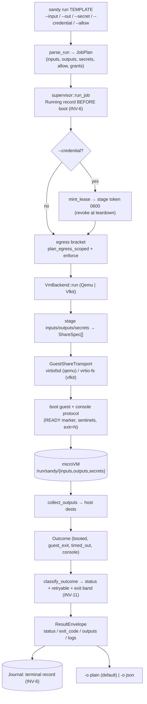
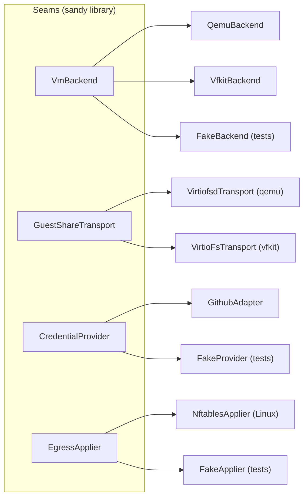

# sandy architecture: overview (level 1)

The orientation map: what sandy does, the seams it is built on, and how one
`sandy run` flows through them. For a subsystem's decisions and its KPI (the
tests that verify it), read [`spec.md`](spec.md). This page is the index into it.
The full decision records are in [`../decisions/`](../decisions); the live
acceptance matrix (what must pass to ship) is in [`kpi.md`](kpi.md).

## What sandy is

sandy runs one job in an ephemeral NixOS microVM and returns a **locked result
envelope**. It owns the hypervisor launch natively (qemu on Linux,
vfkit on macOS) behind one `VmBackend` seam, delivers inputs/outputs/secrets and a
scoped forge credential over virtio-fs shares, enforces an egress allow-list around
the boot, and classifies the outcome into a status + a process exit band that never
disagree (INV-11).

## The run pipeline

One `sandy run` is a straight-line pipeline. The CLI parses flags into a `JobPlan`;
the supervisor brackets the backend boot with the egress boundary (and, for a
credentialed run, a mint→revoke bracket); the backend stages the shares, launches
the guest, drives it over the console protocol, collects outputs, and returns the
physical `Outcome`; the supervisor classifies it into the envelope and persists it.

## The seams

Every hard boundary is a trait with one implementation per target, so a subsystem
can grow without widening the library's surface. These are the extension points.

## Subsystem map

Each row links to its detailed spec section, and names the one invariant it turns
on and the crate it lives in.

| Subsystem                                                            | What it owns                                | Key invariant                            | Crate                            |
| -------------------------------------------------------------------- | ------------------------------------------- | ---------------------------------------- | -------------------------------- |
| [Run plane](spec.md#1-run-plane-vmbackend)                           | native hypervisor launch + console protocol | never green from a fake (INV-S9)         | `sandy-backend`                  |
| [Guest shares](spec.md#2-guest-shares-guestsharetransport)           | inputs/outputs/secrets as virtio-fs         | RO enforced at the host boundary (INV-1) | `sandy-backend` + `sandy::stage` |
| [Secret channel](spec.md#3-secret-channel)                           | `$NAME` delivery, never argv/env/store      | secrets off the data plane (INV-1)       | `sandy::stage`                   |
| [Credential seam](spec.md#4-credential-seam-credentialprovider)      | mint → stage → refresh → revoke             | fail-closed mint (INV-7)                 | `sandy::cred`                    |
| [Egress](spec.md#5-egress)                                           | allow-list around the boot                  | fail-closed, guest-scoped (#29)          | `sandy::egress`                  |
| [Result + classification](spec.md#6-result-envelope--classification) | locked envelope, exit bands                 | status ⇔ band ⇔ retryable (INV-11)       | `sandy::result`                  |
| [Journal](spec.md#7-journal)                                         | durable job records, reconcile              | Running before boot (INV-6)              | `sandy::journal`                 |

## Testing, split two ways

The spec defines each subsystem's KPI as the tests that prove it, in two distinct
tiers (see [spec.md § Testing](spec.md#testing-integration-vs-end-to-end)):

- **Integration tests**, tier-2, run in CI, **no hypervisor**: the pure argv
  assemblers, the staging/collection functions, and the supervisor over
  `FakeBackend`. They prove wiring and classification without a boot.
- **End-to-end tests**, tier-3, **host-gated behind the `live` feature**, a real
  guest boots: the full workflows (a job reads an input + secret + credential and
  writes a collected output). They prove the system behaves, never counted green
  from a fake (INV-S9).
