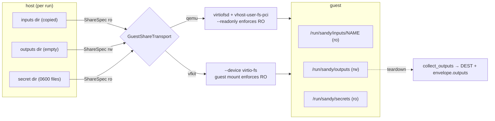
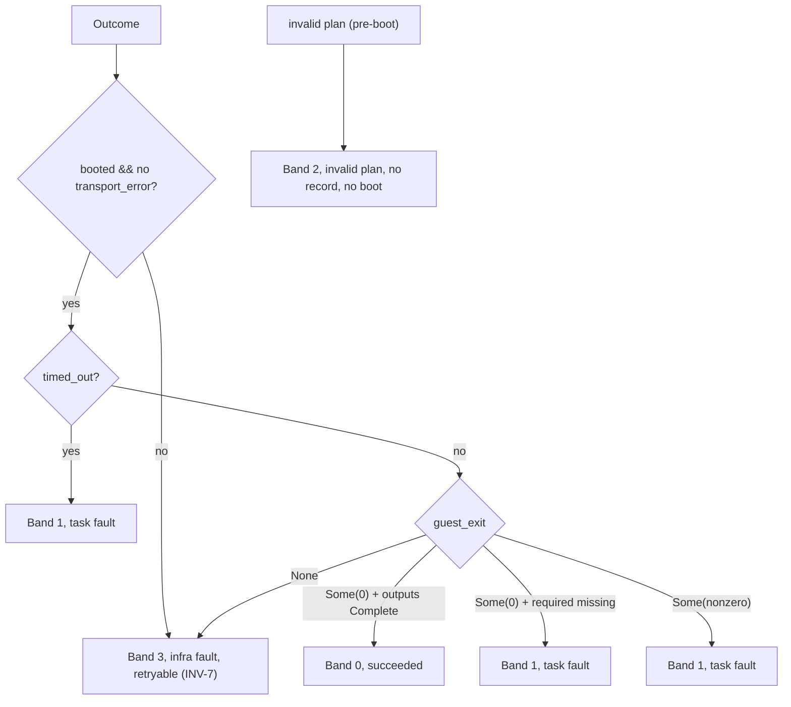

# sandy architecture: detailed spec (level 2)

Per subsystem: its **purpose**, the **decisions** that shape it (with the rationale
and invariant each turns on), and its **KPI**, the tests that prove it, split into
integration (tier-2, CI) and end-to-end (tier-3, live). Read
[`overview.md`](overview.md) first for the pipeline and the seam map. The
**decisions** below are stated tersely; the full record per category (context,
consequences, the alternative set aside) is in [`../decisions/`](../decisions).
The live **KPIs** are consolidated as an acceptance matrix in [`kpi.md`](kpi.md).

Invariants referenced here: **INV-1** secrets never reach argv/env/the store;
**INV-3** liveness only through `VmBackend::boxes` + the job flock, never a direct
registry read; **INV-6** a `Running` record is written before the backend runs and
a terminal record always carries the envelope; **INV-7** fail-closed (a mint or
egress-apply failure is an infra fault, never a degraded run); **INV-8** the
`Outcome` wire record is pinned `snake_case`; **INV-11** `status` ⇔ `retryable` ⇔
process exit band never disagree; **INV-S9** a live scenario is never counted green
from a fake.

---

## 1. Run plane (`VmBackend`)

**Purpose.** Launch the guest natively and drive it to a physical `Outcome`
(`booted`, `guest_exit`, `transport_error`, `timed_out`, `console`).

**Decisions.**

- **One seam, two native backends.** `QemuBackend` (Linux/KVM, serial on `ttyS0`)
  and `VfkitBackend` (macOS/Virtualization.framework, console on `hvc0`) implement
  `VmBackend`. No external VM library; the argv assembly is a pure function so the
  whole topology→argv mapping is unit-testable without spawning.
- **Topology from Nix, not hard-coded.** The VM shape (kernel, initrd, store,
  cpu/mem, shares, hypervisor) is a typed `Topology` read from a guest flake attr
  via `nix eval --json`; Nix still builds the artifacts.
- **Console protocol.** The driver waits for the `SANDY-READY` marker, injects a
  base64-wrapped command bracketed by per-run `<<SANDY-<uuid>-START/END>>`
  sentinels, captures the region between them, and parses a trailing `exit=<n>`. A
  garbled `exit=` is a protocol error, never a defaulted 0.
- **macOS needs a linux-builder.** vfkit requires a matching-arch guest, so an
  aarch64-darwin host builds its aarch64-linux guest on a remote `aarch64-linux`
  builder; `sandy doctor` refuses and names the fix when nix or the builder is
  missing.
- **A live control handle, not a timeout fixed at the start (#340).**
  `RunSpec.control: &RunControl` carries a cancellation flag and a mutable
  deadline (`None` = suspended, no deadline enforced) that something outside
  the run — `daemon cancel`, sandyd's M2 attach-state signaling
  (`docs/decisions/sandyd.md` decision 14's amendment) — can flip or move
  while the job is still running, instead of a `u32` seconds value baked
  into one `Instant` computed once at the start. `ProcessBackend`'s poll
  loop reads it live each tick; the VM backends thread it through `RunSpec`
  for contract compliance but don't yet honor it dynamically (named as an
  explicit gap in the decision record, not silently left).

**KPI.**

- Integration: `qemu_args` / `vfkit_args` argv assembly and the console protocol
  (sentinel framing, `parse_exit`) as unit tests; `host_matrix` classification over
  a real observation.
- End-to-end: `live_boot.rs` tests `real_boot_collect_succeeds`,
  `cli_lifecycle_over_a_real_job`, `guest_failure_is_a_task_fault`.

---

## 2. Guest shares (`GuestShareTransport`)

**Purpose.** Present host directories to the guest as virtio-fs mounts, the same
`fsType = "virtiofs"` on both backends, for inputs (RO), outputs (RW), and the
secret share (RO).



**Decisions.**

- **virtio-fs everywhere, one guest config.** The guest statically mounts fixed
  tags (`sandy-inputs`, `sandy-outputs`, `sandy-secrets`) with `nofail`. qemu serves
  them with a `virtiofsd` daemon per share + a `vhost-user-fs-pci` device (9p was
  the original bug: the guest mounted virtiofs, qemu emitted `-virtfs`, the tag
  never resolved); vfkit serves virtio-fs natively.
- **Read-only at the host boundary (INV-1).** On qemu `--readonly` is passed to
  `virtiofsd`, so a guest-root remount-rw still cannot write the host dir; vfkit
  relies on the guest mount's `ro` (its virtio-fs device rejects a `,ro` arg). A
  write to an input fails `EROFS`.
- **Inputs copied, outputs collected.** Inputs are copied under their name into one
  fixed-tag share (fine for typical inputs; a no-copy/arbitrary-path variant is
  deferred, #82). Outputs are a writable share collected to the host dest at
  teardown and listed in `envelope.outputs`. Collection **skips symlinks** (a job
  dropping `out/x → /etc/shadow` neither leaks bytes nor plants a host-escaping
  link) and caps bytes/entries.
- **Fixed tags, not pooled.** A single fixed tag per channel lets the guest mount
  statically; it is what made the pooled-`sandy<N>` dynamic-mount model unnecessary.
- **Host staging base validated before use (CWE-732).** All three backends derive
  their per-run dirs from one host staging base
  (`temp_dir()/sandy`); `ensure_sandy_staging_base` creates it `0700`, or, if it
  already exists, opens it with `O_NOFOLLOW` and rejects it unless it is owned by
  the current uid with no group/world write bit. A bad base fails closed, never
  gets chmod'd/chowned back into shape.

**KPI.**

- Integration: `sandy-backend/tests/shares.rs`, a staged input/output reaches the
  real `qemu_args`/`vfkit_args` with the right tag and RO/RW flag (`--readonly` vs
  not), a missing host input fails closed, named + catch-all collection, the
  symlink-escape is skipped, and only the outputs share is writable.
- End-to-end: `live_inputs.rs` (readable, write → `EROFS`); `live_outputs.rs` (named
  and catch-all collected, listed in the envelope); and
  `live_boot.rs::secret_share_mounts_read_only_virtiofs` (virtiofs fstype, guest
  write denied).
- Unit: `sandy-backend/src/staging.rs`, a world-writable or symlinked base is
  rejected, an owner/mode mismatch is rejected, a clean self-owned base validates.

---

## 3. Secret channel

**Purpose.** Deliver a named secret to the job as `$NAME` without it ever touching
argv, env, or the Nix store.

**Decisions.**

- **On-disk channel only (INV-1).** Each secret is staged to a `0600` file (atomic
  temp→fsync→rename) in a `0700` dir shared read-only at `sandy-secrets`; the guest
  login shell exports each file as its `$NAME`. A world/group-readable source is
  rejected, not staged. `validate_no_secret_leak` rejects a secret whose name is
  also set as a plain env var.
- **Caller-owned dir for refresh.** `RunSpec.secret_dir` lets the credential bracket
  stage into a dir it keeps rewriting mid-run (the share is the live virtiofs dir,
  so a rewrite is seen in-guest), the refresh re-delivery hook.

**KPI.**

- Integration: `stage/secrets.rs` unit tests (perms, atomic rename, wipe,
  world-readable rejection); `validate_no_secret_leak` tests.
- End-to-end: `live_boot.rs::staged_secret_is_exported_to_the_job_env`.

---

## 4. Credential seam (`CredentialProvider`)

**Purpose.** Mint a short-lived, least-privilege forge token for a job, deliver it
in-guest, refresh it mid-run, and revoke it at teardown.

```mermaid
sequenceDiagram
  participant S as supervisor
  participant P as CredentialProvider
  participant B as VmBackend
  participant G as guest
  S->>P: mint(scope, ttl)
  P-->>S: Minted(token, expiry, handle)
  S->>S: stage token 0600 in cred_dir (secret_dir)
  S->>B: run (plan + secret_dir)
  B->>G: boot; token exported as $GITHUB_TOKEN
  loop refresh loop (margin/tick)
    S->>P: refresh(lease)
    P-->>S: Minted(new token)
    S->>S: rewrite cred_dir/<NAME> (live share)
    note over G: git credential fill serves the new token
  end
  S->>P: revoke(lease) at teardown
```

**Decisions.**

- **Mint → stage → revoke bracket, fail-closed (INV-7).** `run_job_with_credential`
  mints before boot; a mint failure returns an infra fault with **no boot**. The
  lease is revoked on every path.
- **Trust root, not a shared server.** The provider is a GitHub App whose private
  key stays on the controller (`sandy cred github register/import/verify/deregister`);
  each job mints an installation token scoped to its repos/capabilities. The minted
  token is a secret, delivered over the secret channel (§3).
- **Mid-run refresh.** With a huge margin + short tick the refresh thread re-mints
  and rewrites the live secret file, so a long job's `git credential fill` serves a
  fresh token; the guest never sees the value on argv/console.
- **`gc` sweeps a leaked `cred-*`/`verify-*` staging dir (#195).** The drop guard
  that removes `cred_dir`/the verify probe's temp dir runs on every normal exit
  and on panic, but not on SIGKILL or a crash before it runs; `sandy gc` sweeps any
  such dir under the sandy staging base whose mtime is at least `MAX_TTL_SECS` old.
  The refresh loop heartbeats `cred_dir`'s mtime every tick (not only on an actual
  refresh), since a provider's native token TTL can outlast `MAX_TTL_SECS` between
  refreshes; without it, `gc` could delete a live job's credential dir. The sweep
  is best-effort: a staging base that can't be validated or listed is logged and
  skipped, never blocking `gc`'s record eviction. A stalled refresh call could
  itself block the heartbeat (the two run sequentially), so every GitHub API
  call (mint, refresh, revoke, uninstall, the permissions read) runs under a single
  wall-clock deadline, `CALL_DEADLINE = MAX_TTL_SECS / 2`, covering the whole
  call including whatever retries octocrab makes internally, closing the gap
  at its source rather than only at the heartbeat. See decision 6 for the
  residual gaps this doesn't close.

**KPI.**

- Integration: `cred.rs` unit tests (`mint_lease` clamps TTL, stages 0600, revoke
  bracket, `should_refresh`); the supervisor's mint-fails-closed test;
  `sandy-fsutil`'s `sweep_stale_staging_dirs` tests (sweeps a stale dir, keeps a
  fresh one, ignores an unrelated prefix, continues past an unremovable one);
  the supervisor's `gc_sweeps_a_stale_cred_dir_past_max_ttl` /
  `gc_keeps_a_fresh_verify_dir` /
  `refresh_loop_heartbeats_the_cred_dir_mtime_every_tick` /
  `safe_heartbeat_tick_passes_through_a_safe_tick` /
  `safe_heartbeat_tick_falls_back_when_the_tick_reaches_max_ttl_secs` /
  `..._exceeds_max_ttl_secs`; `cred_github.rs`'s
  `revoke_times_out_on_a_stalled_server` (drives the real adapter's `revoke`
  against a local listener that accepts and never responds, proving the call
  errors out at `call_deadline` rather than hanging).
- End-to-end: `live_cred.rs` (git-helper + mid-run refresh + revoke; the "everything"
  scenario composing cred + secret + input + output), `live_refresh.rs` (a rotated
  token reaches the running guest). Adapter-live (real App): `cred_e2e.rs` /
  `sandy/tests/cred_github_live.rs`, operator-gated.

---

## 5. Egress

**Purpose.** Bracket the boot with an allow-list so the guest's network is filtered,
never the host's.

**Decisions.**

- **Guest-scoped, fail-closed (#29, INV-7).** On Linux with a bound tap, a
  guest-scoped nftables **forward** ruleset filters only the guest and can never
  lock the host off the network; if the boundary can't be applied, the run fails
  closed (band 3) rather than booting unprotected. It is always reverted, on the ok
  and the error path, so a boot failure never leaves rules up.
- **macOS is a no-op.** `plan_egress_scoped` yields `NoBoundary`; the run proceeds
  without enforcement (documented, not silent).

**KPI.**

- Integration: `egress` unit tests (ruleset generation, `plan_egress_scoped`);
  `cli_jobs` `run_on_linux_applies_the_allow_list_ruleset_and_reverts_it` /
  `..._macos_applies_no_boundary` / apply-failure-fails-closed (over `FakeApplier`).
- End-to-end: `live_egress.rs` (Linux + root + `nft`), real nftables around a boot.

---

## 6. Result envelope + classification

**Purpose.** Turn a physical `Outcome` into the locked `ResultEnvelope` and a
process exit band that agree (INV-11).



**Decisions.**

- **Locked envelope.** `status` / `retryable` / `exit_code` are authoritative and
  cross-checked (INV-11): band 3 (infra) is the only retryable band; an invalid
  plan is band 2 with no journal record and no boot (the silent-run guard).
- **Outputs populated.** After a successful run the supervisor lists each declared
  output's collected files as `OutputRef`s (`<name>/<rel>` named, `<rel>`
  catch-all), independent of the host dest. Receipts/provenance remain placeholders.
- **Two renderings.** `-o plain` (default, human, lists outputs) and `-o json` (the
  full serialized envelope) stay in lock-step through the `format_*` helpers.
- **Non-fatal faults surface as `warnings`.** A fault that must not fail an
  otherwise-successful run (e.g. a credential revoke failing at teardown, L-12)
  is named in `warnings: Vec<String>` — schema bumped to `2`, old records still
  deserialize (`#[serde(default)]`) — never just a log line.

**KPI.**

- Integration: `result.rs` `classify_outcome` tests (all bands incl. timeout +
  required-missing) and the schema-bump regression
  (`an_old_schema_v1_record_with_no_warnings_key_deserializes_to_empty`);
  `cli_jobs` band tests (`run_positive`, `run_guest_failure`, `run_timeout`,
  `run_infra_fault`, `run_invalid_plan`) and
  `run_lists_collected_outputs_in_the_envelope`;
  `credentialed_run_redacts_the_token_from_the_console` and
  `credential_revoke_failure_surfaces_as_a_warning_not_a_fault` (M-6/L-12);
  `output.rs` format tests (default plain, both formats carry outputs and
  `both_formats_carry_warnings`).
- End-to-end: every live test asserts the envelope `status`/`exit_code`; `live_e2e.rs`
  asserts `envelope.outputs` and no secret leak in `logs.tail`.

---

## 7. Journal

**Purpose.** Persist durable job records and reconcile liveness without racing the
owner.

**Decisions.**

- **Running before boot (INV-6).** The `Running` record is the first write, so an
  empty journal proves the backend was never reached; the terminal record always
  carries the envelope.
- **Reconcile through the seam (INV-3).** `ls`/`status`/`wait`/`kill`/`gc` reach
  running state via `reconcile_job` + `VmBackend::boxes` under the job flock, never
  a direct registry read, so a crashed owner is reconciled to a terminal state.

**KPI.**

- Integration: `journal` unit tests; `cli_jobs` ops (`ls`/`status`/`wait`/`kill`/`gc`,
  reconcile of a dead box).
- End-to-end: `live_boot.rs::cli_lifecycle_over_a_real_job` (the ops over a real job).

---

## Testing: integration vs end-to-end

The two tiers are deliberately separate, and a subsystem's KPI names tests from each.

### Integration tests (tier-2, CI)

No hypervisor; run on every PR via `nix build .#checks.<sys>.test` and measured by
the `coverage` check. They prove **wiring and classification**: the pure argv
assemblers, the staging/collection functions, the egress ruleset generation, the
credential mint/stage/revoke bracket, and the whole supervisor over `FakeBackend`.
A live scenario is **never** counted green from a fake (INV-S9), `FakeBackend`
proves the plumbing, not the boot.

- Location: in-crate `#[cfg(test)]` units, plus `sandy-cli/tests/cli_jobs.rs`,
  `sandy-backend/tests/shares.rs`, `sandy-cli/src/output.rs` tests.
- Run: `nix develop -c cargo nextest run` (or `nix flake check -L` for the full gate).

### End-to-end tests (tier-3, live)

A real guest boots. Behind the `live` cargo feature (off by default, so CI and
`nix flake check` never run them) and refusing off-matrix rather than skip-greening
(INV-S9). They prove the system **behaves**: the full workflows end to end.

| Test file                                        | Proves (KPI)                                                                                                                                           |
| ------------------------------------------------ | ------------------------------------------------------------------------------------------------------------------------------------------------------ |
| `live_boot.rs`                                   | a real boot collects output; CLI lifecycle; guest-failure fault; secret exported; secret share RO-virtiofs + write denied; git helper serves the token |
| `live_inputs.rs`                                 | input readable in-guest; write → `EROFS`                                                                                                               |
| `live_outputs.rs`                                | named + catch-all outputs collected to the host + in `envelope.outputs`                                                                                |
| `live_e2e.rs`                                    | input + secret + output compose in one run; no secret leak in `logs.tail`                                                                              |
| `live_cred.rs`                                   | credential via git helper + mid-run refresh + revoke; the "everything" scenario (cred + secret + input + output)                                       |
| `live_refresh.rs`                                | a rotated token reaches the running guest mid-run                                                                                                      |
| `live_egress.rs`                                 | real nftables allow-list around a boot (Linux + root)                                                                                                  |
| `cred_e2e.rs`, `sandy/tests/cred_github_live.rs` | the real GitHub App adapter (operator-gated)                                                                                                           |

Run on a host with a hypervisor, e.g. on Apple silicon:

```sh
nix shell nixpkgs#vfkit -c \
  env SANDY_LIVE=1 cargo nextest run -p sandy-cli --features live
```

The credential refresh tests additionally need `SANDY_REFRESH_MARGIN_SECS` +
`SANDY_REFRESH_TICK_SECS` set to force a mid-run refresh (they refuse on defaults,
INV-S9). The real-App adapter tests need a registered trust root
(`SANDY_CRED_LIVE_TRUST_ROOT`) and are operator-gated.

## Test discipline: functional red before green

A compile-red → green transition proves nothing on its own: a test that only
fails because the API doesn't exist yet (a compile error, or a stub panicking
on `unimplemented!()`) hasn't exercised any behavior, so making it pass by
filling in the implementation never demonstrated the test would catch a
regression.

- **Compile-red is a valid _first_ red for an absent boundary.** A test against
  a function, trait, or wire type that doesn't exist yet fails to build, or
  builds and panics on `unimplemented!()`. That's the correct starting point
  when the contract itself hasn't landed.
- **Once the signature exists, red must become functional before green.**
  Iterate the test against a stub or a deliberately wrong implementation until
  it fails for a real reason — an assertion comparing actual behavior, not a
  missing symbol or a panic from an empty body. Only then make it pass.
- **ATDD outer loop, TDD inner loop.** An acceptance test starts red-for-
  absent-contract (the seam isn't built yet), then functional-red at the
  contract boundary once it is. Each slice inside that loop gets its own
  functional-red before its own green.
- **Record the functional red.** A comment, or a mutation/stub note, in the
  test (or its commit) states what it failed on before passing, so a reviewer
  — human or bot — can tell a real regression test from one that went straight
  from "doesn't compile" to "passes."

**Example (#272).** `live_m2_cross_machine.rs` scaffolded its two tests as
deliberately `unimplemented!()`-bodied, since `sandy-executor-proto` (#263)
hadn't landed yet when it was written — that panic was the valid first red for
a contract that didn't exist. Once the crate landed and the bodies got filled
in for real, the discipline required one more step before green: each test had
to first fail on its own assertion (the cross-machine peer-message exchange
didn't happen, or happened wrong) against a stub or partial implementation,
proving the test would actually catch that failure — not jump straight from
`unimplemented!()` to a passing run.
