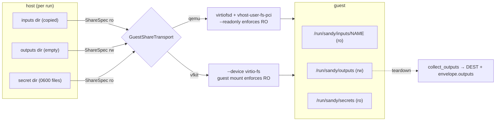
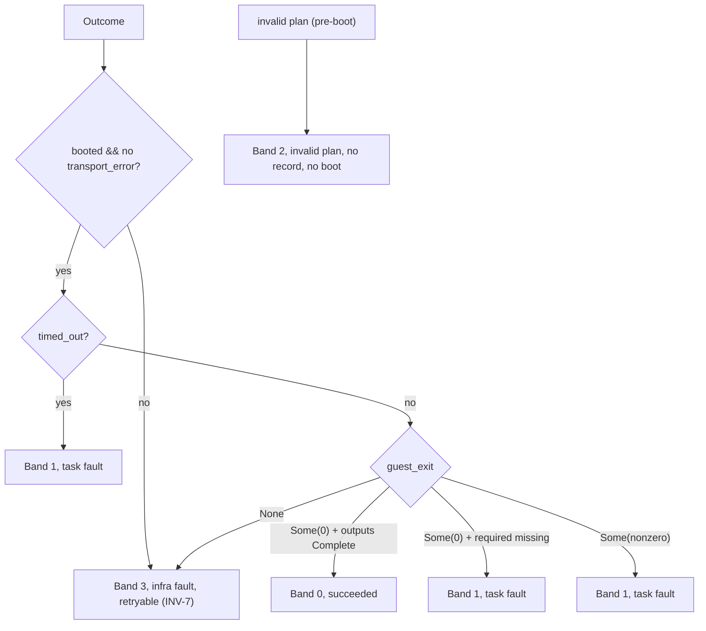

# sandy architecture: detailed spec (level 2)

Per subsystem: its **purpose**, the **decisions** that shape it (with the rationale
and invariant each turns on), and its **KPI**, the tests that prove it, split into
integration (tier-2, CI) and end-to-end (tier-3, live). Read
[`overview.md`](overview.md) first for the pipeline and the seam map. The
**decisions** below are stated tersely; the full record per category (context,
consequences, the alternative set aside) is in [`../decisions/`](../decisions).
The live **KPIs** are consolidated as an acceptance matrix in [`kpi.md`](kpi.md).

Invariants referenced here: **INV-1** secrets never reach argv/env/the store
([attacker model](#attacker-model)); **INV-3** liveness only through
`VmBackend::boxes` + the job flock, never a direct registry read ([attacker
model](#attacker-model)); **INV-6** a `Running` record is written before the
backend runs and a terminal record always carries the envelope; **INV-7**
fail-closed (a mint or egress-apply failure is an infra fault, never a degraded
run) ([attacker model](#attacker-model)); **INV-8** the `Outcome` wire record is
pinned `snake_case`; **INV-11** `status` ⇔ `retryable` ⇔ process exit band never
disagree; **INV-S9** a live scenario is never counted green from a fake.

---

## Attacker model

The security invariants above assume a hostile job inside the sandbox. The
[Agent Compute Engine design](https://cloud.google.com/blog/topics/ai-infrastructure/agent-compute-engine-deep-dive)
(accessed 2026-10-24) states the same baseline: assume the attacker controls
everything inside the sandbox, and leave nothing useful there to find.

**Actors.**

| Actor                                     | Defended by                                                                                                        |
| ----------------------------------------- | ------------------------------------------------------------------------------------------------------------------ |
| hostile job in the guest                  | covered in depth below                                                                                             |
| sibling job on the same executor host     | `sandyd.md` decision 6 (per-run link token)                                                                        |
| a mesh peer that isn't the right executor | `sandyd.md` decisions 6, 12                                                                                        |
| over-reaching submitter                   | `sandyd.md` decision 11 (submitter caps)                                                                           |
| another local user on the controller      | staging-base and trust-root checks (#138, `credential-seam.md` decision 4); `sandyd.md` decision 24 (UDS peer uid) |

**Isolation class.** The hostile-job model applies to the VM backends,
`QemuBackend` and `VfkitBackend`: a hostile job runs inside their strong
boundary. The process backend is trusted-only and never admits an untrusted
job, with any containment, on any host (`process-containment.md` decision 6,
#150), so a hostile job on the process backend is outside this model by
policy, not by luck.

**The hostile job, in depth.** A compromised guest can run arbitrary code as
root inside the guest, read anything mounted or exported into the job (inputs,
the secret share, its own outputs), and reach anything the egress allow-list
permits.

The design still guarantees, even from inside a compromised guest:

- no trust-root key and no channel signing key ever reach the guest
  (`credential-seam.md` decisions 2 and 4);
- no agent capability token in the job's environment;
- on qemu, input and secret shares stay read-only enforced host-side by
  `--readonly` on `virtiofsd`: a guest-root remount-rw still gets `EROFS` on
  write;
- on qemu, the qemu process runs under seccomp (`-sandbox on`, `qemu_args`), so a device-bug escape does not get
  the sandy user's full syscall surface (#392). Each `virtiofsd` runs under its default seccomp filter in the host's
  namespaces (`--sandbox=none`; namespace mode does not start under the executor unit, `guest-shares.md` decision 3,
  #523). Resource limits (cgroup) are not yet enforced;
- **no egress at all on macOS, until #360.** `vfkit_args`
  (`impls/vm/src/vfkit.rs`) emits no `virtio-net` device, so a macOS guest has
  no NIC to reach anything over: denied by construction, not merely
  unfiltered (`egress.md` decision 2). A non-empty `--allow` list has no
  effect there either and the envelope's `warnings` says so (#358). This
  guarantee ends once #360 gives guests network.

It does not guarantee:

- **vfkit's RO shares are guest-cooperative, not host-enforced.** vfkit's
  virtio-fs device has no read-only option, so RO rests on the guest's own
  `ro` mount; a guest-root remount-rw can defeat it (`guest-shares.md`
  decision 2). Each share is a single per-run dir wiped at teardown, so the
  damage is confined to that run's own staging, not a host escape.
- **token exfiltration, bounded by revocation, not TTL.** The minted forge
  token is staged on the secret share and exported in-guest as
  `$GITHUB_TOKEN` (`credential-seam.md` decisions 2-3); egress has to allow
  the forge for git to work. A hostile job can read and exfiltrate the
  token. The copy stays usable only until the controller revokes it: at the
  next refresh (which supersedes and revokes the stale token,
  `credential-seam.md` decision 3) or at job teardown at the latest
  (`credential-seam.md` decision 1's revoke-on-every-path), whichever comes
  first, not its full native TTL. The token is also narrowly scoped.
  Recorded as an interim risk in `credential-seam.md`.
- **guest-to-host traffic on Linux.** The egress ruleset filters the forward
  chain only (`egress.md` decision 1); traffic the guest sends to the host
  itself is not filtered. #376 tracks closing this.

---

## 1. Run plane (`VmBackend`)

**Purpose.** Launch the guest natively and drive it to a physical `Outcome`
(`booted`, `guest_exit`, `transport_error`, `timed_out`, `console`).

**Decisions.**

- **One seam, two native backends.** `QemuBackend` (Linux/KVM, serial on `ttyS0`)
  and `VfkitBackend` (macOS/Virtualization.framework, console on `hvc0`) implement
  `VmBackend`. No external VM library; the argv assembly is a pure function so the
  whole topology→argv mapping is unit-testable without spawning.
- **Topology from Nix, not hard-coded.** The VM shape (kernel, initrd, store,
  cpu/mem, shares, hypervisor) is a typed `Topology` read from a guest flake attr
  via `nix eval --json`; Nix still builds the artifacts.
- **Console protocol.** The driver waits for the `SANDY-READY` marker, injects a
  base64-wrapped command bracketed by per-run `<<SANDY-<uuid>-START/END>>`
  sentinels, captures the region between them, and parses a trailing `exit=<n>`. A
  garbled `exit=` is a protocol error, never a defaulted 0.
- **macOS needs a linux-builder.** vfkit requires a matching-arch guest, so an
  aarch64-darwin host builds its aarch64-linux guest on a remote `aarch64-linux`
  builder; `sandy doctor` refuses and names the fix when nix or the builder is
  missing.
- **A live control handle, not a timeout fixed at the start (#340).**
  `RunSpec.control: &RunControl` carries a cancellation flag and a mutable
  deadline (`None` = suspended, no deadline enforced) that something outside
  the run — `daemon cancel`, sandyd's M2 attach-state signaling
  (`docs/decisions/sandyd.md` decision 14's amendment) — can flip or move
  while the job is still running, instead of a `u32` seconds value baked
  into one `Instant` computed once at the start. `ProcessBackend`'s poll
  loop reads it live each tick; so does the VM console driver (#185, decision
  14's amendment): `run_console`'s per-phase (boot/command) budget stays
  authoritative for a run nothing ever touches, but the moment something
  moves the control's deadline away from the value it carried when the run
  started, the live value takes over — and `is_cancelled()` always ends the
  run immediately, in either phase.
- **A short poll quantum, not a read bound to the whole budget (#185).** The
  console socket/PTY read timeout is a fixed ~250ms poll quantum
  (`console::POLL_QUANTUM`), reported to the driver as `ReadEvent::Idle`
  (distinct from `ReadEvent::Closed`, real EOF) rather than the old `Ok(0)`
  that conflated the two. This is what lets `run_console` re-check the live
  `RunControl` on every tick instead of blocking for the whole run on one
  read call.

**KPI.**

- Integration: `qemu_args` / `vfkit_args` argv assembly and the console protocol
  (sentinel framing, `parse_exit`) as unit tests; `host_matrix` classification over
  a real observation; `console::tests` drives `run_console` against a scripted
  `Transport` and a real `RunControl` over genuine elapsed time (suspend/cancel/
  idle-vs-closed, #185).
- End-to-end: `live_boot.rs` tests `real_boot_collect_succeeds`,
  `cli_lifecycle_over_a_real_job`, `guest_failure_is_a_task_fault`.

---

## 2. Guest shares (`GuestShareTransport`)

**Purpose.** Present host directories to the guest as virtio-fs mounts, the same
`fsType = "virtiofs"` on both backends, for inputs (RO), outputs (RW), and the
secret share (RO).



**Decisions.**

- **virtio-fs everywhere, one guest config.** The guest statically mounts fixed
  tags (`sandy-inputs`, `sandy-outputs`, `sandy-secrets`) with `nofail`. qemu serves
  them with a `virtiofsd` daemon per share + a `vhost-user-fs-pci` device (9p was
  the original bug: the guest mounted virtiofs, qemu emitted `-virtfs`, the tag
  never resolved); vfkit serves virtio-fs natively.
- **Read-only at the host boundary (INV-1).** On qemu `--readonly` is passed to
  `virtiofsd`, so a guest-root remount-rw still cannot write the host dir; vfkit
  relies on the guest mount's `ro` (its virtio-fs device rejects a `,ro` arg). A
  write to an input fails `EROFS`.
- **Inputs copied, outputs collected.** Inputs are copied under their name into one
  fixed-tag share (fine for typical inputs; a no-copy/arbitrary-path variant is
  deferred, #82). Outputs are a writable share collected to the host dest at
  teardown and listed in `envelope.outputs`. Collection **skips symlinks** (a job
  dropping `out/x → /etc/shadow` neither leaks bytes nor plants a host-escaping
  link) and caps bytes/entries.
- **Fixed tags, not pooled.** A single fixed tag per channel lets the guest mount
  statically; it is what made the pooled-`sandy<N>` dynamic-mount model unnecessary.
- **Host staging base validated before use (CWE-732).** All three backends derive
  their per-run dirs from one host staging base
  (`temp_dir()/sandy`); `ensure_sandy_staging_base` creates it `0700`, or, if it
  already exists, opens it with `O_NOFOLLOW` and rejects it unless it is owned by
  the current uid with no group/world write bit. A bad base fails closed, never
  gets chmod'd/chowned back into shape.
- **A caller's `secret_dir` is re-checked by fingerprint, not trusted by path
  (CWE-367, #323).** `RunSpec::secret_dir` carries `(path, DirFingerprint)`, the
  `(dev, ino)` the caller validated before building the spec; `plan_shares`
  reopens it with `OwnedDir::open_matching`, refusing a same-uid, same-mode
  directory swapped in at that path since. See decision 13 in
  `docs/decisions/guest-shares.md`. This protects the staging reopen only: the
  later transport resolves `ShareSpec.host_dir` by path, so a path replacement
  after `plan_shares` returns remains a transport-level limitation.

**KPI.**

- Integration: `sandy-backend/tests/shares.rs`, a staged input/output reaches the
  real `qemu_args`/`vfkit_args` with the right tag and RO/RW flag (`--readonly` vs
  not), a missing host input fails closed, named + catch-all collection, the
  symlink-escape is skipped, and only the outputs share is writable.
- End-to-end: `live_inputs.rs` (readable, write → `EROFS`); `live_outputs.rs` (named
  and catch-all collected, listed in the envelope); and
  `live_boot.rs::secret_share_mounts_read_only_virtiofs` (virtiofs fstype, guest
  write denied).
- Unit: `sandy-backend/src/staging.rs`, a world-writable or symlinked base is
  rejected, an owner/mode mismatch is rejected, a clean self-owned base validates;
  `sandy/src/shares.rs::a_secret_dir_swapped_after_validation_is_never_staged_into`
  (adversarial, #323); `sandy-fsutil/src/secret.rs`'s
  `open_matching_refuses_a_same_uid_mode_substitute_swapped_in_at_the_path`.

---

## 3. Secret channel

**Purpose.** Deliver a named secret to the job as `$NAME` without it ever touching
argv, env, or the Nix store.

**Decisions.**

- **On-disk channel only (INV-1).** Each secret is staged to a `0600` file (atomic
  temp→fsync→rename) in a `0700` dir shared read-only at `sandy-secrets`; the guest
  login shell exports each file as its `$NAME`. A world/group-readable source is
  rejected, not staged. `validate_no_secret_leak` rejects a secret whose name is
  also set as a plain env var.
- **Caller-owned dir for refresh.** `RunSpec.secret_dir` lets the credential bracket
  stage into a dir it keeps rewriting mid-run (the share is the live virtiofs dir,
  so a rewrite is seen in-guest), the refresh re-delivery hook.

**KPI.**

- Integration: `stage/secrets.rs` unit tests (perms, atomic rename, wipe,
  world-readable rejection); `validate_no_secret_leak` tests.
- End-to-end: `live_boot.rs::staged_secret_is_exported_to_the_job_env`.

---

## 4. Credential seam (`CredentialProvider`)

**Purpose.** Mint a short-lived, least-privilege forge token for a job, deliver it
in-guest, refresh it mid-run, and revoke it at teardown.

```mermaid
sequenceDiagram
  participant S as supervisor
  participant P as CredentialProvider
  participant B as VmBackend
  participant G as guest
  S->>P: mint(scope, ttl)
  P-->>S: Minted(token, expiry, handle)
  S->>S: stage token 0600 in cred_dir (secret_dir)
  S->>B: run (plan + secret_dir)
  B->>G: boot; token exported as $GITHUB_TOKEN
  loop refresh loop (margin/tick)
    S->>P: refresh(lease)
    P-->>S: Minted(new token)
    S->>S: rewrite cred_dir/<NAME> (live share)
    note over G: git credential fill serves the new token
  end
  S->>P: revoke(lease) at teardown
```

**Decisions.**

- **Mint → stage → revoke bracket, fail-closed (INV-7).** `run_job_with_credential`
  mints before boot; a mint failure returns an infra fault with **no boot**. The
  lease is revoked on every path.
- **Trust root, not a shared server.** The provider is a GitHub App whose private
  key stays on the controller (`sandy cred github register/import/verify/deregister`);
  each job mints an installation token scoped to its repos/capabilities. The minted
  token is a secret, delivered over the secret channel (§3).
- **Mid-run refresh.** With a huge margin + short tick the refresh thread re-mints
  and rewrites the live secret file, so a long job's `git credential fill` serves a
  fresh token; the guest never sees the value on argv/console.
- **Terminal journal write deferred until redaction is final (#322).** The
  non-credentialed path still writes its terminal record inside `run_job`, right
  after its one redaction pass. `run_job_with_credential` instead runs the shared
  core without writing that record, joins the refresh thread, re-redacts the
  console against every token the run ever had live, folds in a revoke-failure
  warning if any, and only then writes the terminal record — once. Before this,
  `run_job` wrote a terminal record redacted against only the initial token, and
  `run_job_with_credential` amended it after the fact; a crash in that window left
  a permanent record with a refreshed token unredacted. See INV-6 (§7).
- **`gc` sweeps a leaked `cred-*`/`verify-*` staging dir (#195).** The drop guard
  that removes `cred_dir`/the verify probe's temp dir runs on every normal exit
  and on panic, but not on SIGKILL or a crash before it runs; `sandy gc` sweeps any
  such dir under the sandy staging base whose mtime is at least `MAX_TTL_SECS` old.
  The refresh loop heartbeats `cred_dir`'s mtime every tick (not only on an actual
  refresh), since a provider's native token TTL can outlast `MAX_TTL_SECS` between
  refreshes; without it, `gc` could delete a live job's credential dir. The sweep
  is best-effort: a staging base that can't be validated or listed is logged and
  skipped, never blocking `gc`'s record eviction. A stalled refresh call could
  itself block the heartbeat (the two run sequentially), so every GitHub API
  call (mint, refresh, revoke, uninstall, the permissions read) runs under a single
  wall-clock deadline, `CALL_DEADLINE = MAX_TTL_SECS / 2`, covering the whole
  call including whatever retries octocrab makes internally, closing the gap
  at its source rather than only at the heartbeat. `safe_heartbeat_tick` caps
  a configured tick against `MAX_TTL_SECS - CALL_DEADLINE`, not `MAX_TTL_SECS`
  alone, so an accepted tick always leaves room for one stalled call. See
  decision 6 for the residual gap this doesn't close.
- **`cred_dir` is bound by fingerprint through mint and every refresh (CWE-367,
  #323).** `run_credentialed` captures `cred_dir`'s `(dev, ino)` from the
  `OwnedDir` `private_staging_dir` returns before reducing it to a path.
  `mint_lease_checked`/`refresh_once_checked` reopen `cred_dir` with
  `OwnedDir::open_matching` against that fingerprint instead of `mint_lease`'s/
  `refresh_once`'s plain owner/mode reopen, so a same-uid, same-mode directory
  swapped in at `cred_dir`'s path between validation and the mint, or between
  two refreshes, is refused rather than silently receiving the token. See
  decision 13 in `docs/decisions/guest-shares.md`.

**KPI.**

- Integration: `cred.rs` unit tests (`mint_lease` clamps TTL, stages 0600, revoke
  bracket, `should_refresh`);
  `mint_lease_checked_refuses_a_dir_swapped_in_after_validation` (adversarial,
  #323); the supervisor's mint-fails-closed test;
  `credentialed_run_writes_the_terminal_record_once_after_refresh_redaction`
  (decision 7 of `credential-seam.md`: the deferred write, exactly once, after
  refresh redaction);
  `sandy-fsutil`'s `sweep_stale_staging_dirs` tests (sweeps a stale dir, keeps a
  fresh one, ignores an unrelated prefix, continues past an injected removal
  failure deterministically via `sweep_stale_staging_dirs_with`, supplemented
  by a real-filesystem-permission variant); the supervisor's
  `gc_sweeps_a_stale_cred_dir_past_max_ttl` / `gc_keeps_a_fresh_verify_dir`
  (both asserting against `GcReport::swept_staging_dirs`, never `evicted`) /
  `refresh_loop_heartbeats_the_cred_dir_mtime_every_tick` /
  `safe_heartbeat_tick_passes_through_a_safe_tick` /
  `safe_heartbeat_tick_falls_back_when_the_tick_reaches_max_ttl_secs` /
  `..._exceeds_max_ttl_secs` /
  `..._falls_back_at_max_ttl_secs_minus_call_deadline` /
  `..._passes_through_just_below_max_ttl_secs_minus_call_deadline`;
  `output.rs`'s `gc_json_keeps_swept_staging_dirs_out_of_evicted` /
  `gc_plain_text_evicted_count_excludes_swept_staging_dirs`; `cred_github.rs`'s
  `revoke_times_out_on_a_stalled_server` (drives the real adapter's `revoke`
  against a local listener that accepts and never responds, proving the call
  errors out at `call_deadline` rather than hanging).
- End-to-end: `live_cred.rs` (git-helper + mid-run refresh + revoke; the "everything"
  scenario composing cred + secret + input + output), `live_refresh.rs` (a rotated
  token reaches the running guest). Adapter-live (real App): `cred_e2e.rs` /
  `sandy/tests/cred_github_live.rs`, operator-gated.

---

## 5. Egress

**Purpose.** Bracket the boot with an allow-list so the guest's network is filtered,
never the host's.

**Decisions.**

- **Guest-scoped, fail-closed (#29, INV-7).** On Linux with a bound tap, a
  guest-scoped nftables **forward** ruleset filters only the guest and can never
  lock the host off the network; if the boundary can't be applied, the run fails
  closed (band 3) rather than booting unprotected. It is always reverted, on the ok
  and the error path, so a boot failure never leaves rules up.
- **Host-destined traffic is covered too (#376).** Traffic from the guest to the
  host itself doesn't cross `forward`; it lands in `input`. `to_nftables_forward`
  also emits an `input`-hook chain scoped to the guest's `iface`: DHCP is allowed,
  everything else from the guest is dropped. An empty allow-list blocks it the
  same as forwarded egress — there is no way to allow-list a host address here
  (see `docs/decisions/egress.md`). IPv4 only, TCP only on the data-plane side;
  no guest DNS is resolved or trusted.
- **macOS is a no-op.** `vfkit_args` (`impls/vm/src/vfkit.rs`) emits no
  `virtio-net` device, so a macOS guest has no NIC at all; `plan_egress_scoped`
  yields `NoBoundary` and the run proceeds without enforcement (documented, not
  silent). A Linux guest with no bound tap has no NIC either, for the same
  reason.
- **A no-NIC guest's `--allow` list warns when non-empty (#358).** With no
  network device (macOS, or Linux without a tap) a non-empty `--allow` list has
  no effect to grant, so the envelope's `warnings` carries `egress unavailable:
the guest has no network device, so --allow entries have no effect (see
#360)`. An empty allow-list does not add an envelope warning. The decision keys on structure
  (`EgressOs::MacOs` or no tap), never on the `Unenforced` reason string. No
  schema bump: `warnings` already exists at schema 2 (section 6).
- **IP-only matching, no guest DNS (#359).** An allow-list entry is an IPv4
  address or IPv4 CIDR plus port; matching is by destination IPv4 address and TCP
  port only — IPv6, UDP, and QUIC from the guest are dropped. The guest gets no
  DNS through the boundary, so a job must connect by IP. A hostname entry is
  refused at plan time on the nftables (Linux) path: band 2, no journal record,
  no boot, naming the entry and #377. nft pins a hostname to one address at
  ruleset-load time, rejects a name with several addresses, and the guest can't
  resolve names through the boundary anyway, so a hostname entry only ever helps
  a job that already connects by IP — refusing it turns that silent no-op into a
  clear error. macOS enforces no boundary, so a hostname entry stays accepted
  there (#358). Hostname policy arrives with the #360 egress proxy (#377), which
  resolves names host-side.
- **Planned: a NIC-less guest with a vsock host proxy (#360).** The guest gets
  no NIC. `sandy-agent egress-relay` serves `127.0.0.1:3128` in the guest and
  sets `HTTP(S)_PROXY` for the job. Each CONNECT crosses vsock to a per-run host
  proxy that the backend owns beside `virtiofsd`. The proxy matches the target
  name or IP and port against the allow-list before any resolution, resolves
  names host-side, refuses loopback and host-local addresses, and refuses
  private addresses the allow-list does not name. A proxy that fails to start
  or dies mid-run is band 3. It replaces both decisions above once qemu and
  vfkit pass the live parity gate. Full record:
  [`../decisions/egress-proxy.md`](../decisions/egress-proxy.md). Planned live
  KPIs: [`kpi.md#planned-egress-proxy`](kpi.md#planned-egress-proxy).

**KPI.**

- Integration: `egress` unit tests (ruleset generation, `plan_egress_scoped`,
  `validate_egress_hosts`); `cli_jobs`
  `run_on_linux_applies_the_allow_list_ruleset_and_reverts_it` /
  `run_on_macos_applies_no_boundary_but_still_succeeds` /
  `run_on_macos_with_an_empty_allow_list_carries_no_warning` /
  `run_on_linux_with_no_tap_and_a_nonempty_allow_list_warns` /
  `run_on_linux_with_no_tap_and_an_empty_allow_list_carries_no_warning` /
  `run_on_the_process_backend_with_a_nonempty_allow_list_warns_with_the_right_cause` /
  `run_hostname_allow_on_linux_is_invalid_plan_writes_no_record_and_never_boots` /
  `run_with_credential_hostname_allow_on_linux_is_invalid_plan_never_mints` /
  apply-failure-fails-closed (over `FakeApplier`).
- End-to-end: `live_egress.rs` (Linux + root + `nft`), real nftables around a boot,
  including the host-destined case (an empty allow-list plus a host-local
  resolver: the guest can't resolve names through it and can't connect to the
  tap's host address).

---

## 6. Result envelope + classification

**Purpose.** Turn a physical `Outcome` into the locked `ResultEnvelope` and a
process exit band that agree (INV-11).



**Decisions.**

- **Locked envelope.** `status` / `retryable` / `exit_code` are authoritative and
  cross-checked (INV-11): band 3 (infra) is the only retryable band; an invalid
  plan is band 2 with no journal record and no boot (the silent-run guard).
- **A dead egress proxy is band 3 (#360).** A backend that finds the run's egress
  proxy exited before it killed it returns `BackendError::EgressProxyDied { status,
booted, guest_exit }`. It is band 3 and retryable whatever the guest exit, so a guest that
  exited 0 without its network never reads as `succeeded`; the envelope message
  names the proxy's exit status and the guest exit. A backend with no proxy support
  refuses a `RunSpec` that carries an egress policy before boot (band 3, no boot).
  Design: [`../decisions/egress-proxy.md`](../decisions/egress-proxy.md) decision 3.
- **Outputs populated.** After a successful run the supervisor lists each declared
  output's collected files as `OutputRef`s (`<name>/<rel>` named, `<rel>`
  catch-all), independent of the host dest. Provenance (`Provenance.template_store_path`)
  remains a placeholder.
- **Two renderings.** `-o plain` (default, human, lists outputs) and `-o json` (the
  full serialized envelope) stay in lock-step through the `format_*` helpers.
- **Non-fatal faults surface as `warnings`.** A fault that must not fail an
  otherwise-successful run (e.g. a credential revoke failing at teardown, L-12)
  is named in `warnings: Vec<String>`. The field was introduced in schema `2`;
  the current envelope is schema `4` (below), and old records still deserialize
  (`#[serde(default)]`) — never just a log line.
- **Envelope receipts v1 (#361).** `ResultEnvelope.receipt: Option<AuditReceipt>`
  (schema `3`, `None` on a pre-`3` record) is audit lineage split by who
  observed each field — an auditor never takes the guest's claim as a host
  fact, following from the attacker model (`#357`, [above](#attacker-model)).
  Distinct from the existing `ResultEnvelope.receipts: Vec<Receipt>` (side-effect
  receipts, e.g. a GitHub PR); the names are intentionally close, the types are not.
  `None` on an invalid-plan run (no `Running` record was ever written) and on
  `kill`'s synthetic cancellation (no backend run to observe).
  - `host_observed` (the guest cannot influence these): `who` (the submitter
    cap's verified `scope.peer` with `authenticated: true`, or the local uid
    with `authenticated: false` — today always the local uid: no run path yet
    derives a verified submitter cap, since sandyd's dispatch core does not
    persist a receipt at all yet, tracked in #413); `what`
    (job id, template ref, and `Option`s for a resolved store path and a
    manifest digest — both `None` today, honestly, rather than an empty-string
    placeholder: no run path threads a resolved store path or a manifest
    object this far yet); `where` (the backend kind — `"qemu"`/`"vfkit"`
    derived from `SandboxKind` + the run's `EgressOs`, `"process"` for the
    process backend — plus `Option`s for a dispatching executor's host id/mesh
    IP, `None` until sandyd dispatch-core exists); `credential` (provider,
    `Scope`, mint/refresh/revoke timestamps, and whether revoke succeeded —
    never the token, `None` for a non-credentialed run); `egress` (`enforced`/
    `unenforced` plus a reason when unenforced, read from the SAME
    `EgressOutcome` that already drives the enforce/revert bracket above — not
    a second copy of the logic, and shared with #358's warning; the allow-list
    actually applied, `None` when nothing was; `attempts`, reserved and empty
    until #375); `timing` (boot start, an `Option` job-start that is `None`
    today since no backend reports that moment, and teardown).
  - `guest_reported` (a hostile guest can shape these): the exit code
    (mirroring `ResultEnvelope.exit_code`) and collected output names/sizes.
  - Content digests (#373, schema `4`, opt-in via `sandy run --digests`): the
    backend hashes each staged input (`host_observed.input_digests`, computed on
    the staged copy before boot) and each collected output
    (`guest_reported.outputs[].sha256`, hashed in the same pass as the copy),
    one sha256 per regular file at its logical path. A symlink or special file
    is recorded as skipped (`guest_reported.skipped_outputs`, reason `symlink` or
    `non_regular`), not omitted. Off, no digest key is serialized and nothing is
    hashed. The collection ceiling stays a hard error, so no entry is dropped
    under it. The staging dirs are wiped at teardown, so the backend reports the
    digests through `Outcome.digests`.
  - Out of v1, tracked: signing (#374), filling `egress.attempts` from the #360
    proxy (#375).

**KPI.**

- Integration: `result.rs` `classify_outcome` tests (all bands incl. timeout +
  required-missing) and the schema-bump regressions
  (`an_old_schema_v1_record_with_no_warnings_key_deserializes_to_empty`,
  `an_old_schema_v2_record_with_no_receipt_key_deserializes_to_none`) and
  `envelope_wire_keys_are_snake_case` (asserts the receipt's nested `where`
  wire key, never `location`) and the digest regressions
  (`an_old_schema_v3_receipt_with_no_digest_keys_deserializes_to_none`,
  `a_receipt_without_digests_serializes_no_digest_keys`,
  `digests_on_hashes_each_collected_file_by_logical_path`,
  `digests_the_staged_copy_with_known_vectors`,
  `run_places_reported_digests_in_the_right_receipt_sections`);
  `cli_jobs` band tests (`run_positive`, `run_guest_failure`, `run_timeout`,
  `run_infra_fault`, `run_invalid_plan`) and
  `run_lists_collected_outputs_in_the_envelope`;
  `credentialed_run_redacts_the_token_from_the_console` and
  `credential_revoke_failure_surfaces_as_a_warning_not_a_fault` (M-6/L-12);
  `run_job_populates_the_receipt_for_a_direct_run`,
  `receipt_reports_unenforced_egress_with_a_reason_and_no_allow_list`,
  `receipt_reports_enforced_egress_with_the_applied_allow_list`,
  `receipt_reports_a_failed_egress_apply_as_unenforced`,
  `credentialed_run_populates_the_receipts_credential_lease`, and
  `no_token_or_secret_bytes_anywhere_in_the_serialized_envelope` (#361);
  `output.rs` format tests (default plain, both formats carry outputs and
  `both_formats_carry_warnings`).
- End-to-end: every live test asserts the envelope `status`/`exit_code`; `live_e2e.rs`
  asserts `envelope.outputs` and no secret leak in `logs.tail`. The receipt is not
  yet asserted on a real boot (`kpi.md`'s "Not yet a KPI").
- **Signing receipts relayed from remote executors (decision 6, #374).**
  Design-only (`docs/decisions/result-classification.md` decision 6): a
  per-executor Ed25519 signature plus a `sandyd` countersignature, answering
  #374's key/format/countersign questions with an adversarial pass.
  Implementation is `#472`, blocked by `#413` (no relay path exists to sign
  until a dispatched job's receipt is persisted at all). Stays out of
  `kpi.md`'s live matrix until #472 lands and is asserted on a real boot.

---

## 7. Journal

**Purpose.** Persist durable job records and reconcile liveness without racing the
owner.

**Decisions.**

- **Running before boot (INV-6).** The `Running` record is the first write, so an
  empty journal proves the backend was never reached; the terminal record always
  carries the envelope. The non-credentialed path writes that terminal record
  right after its own redaction pass. The credentialed path (`run_job_with_credential`,
  #322) defers it instead: the shared core runs without writing one, and only after
  the refresh thread has joined and the console is re-redacted against every token
  the run ever had live does the terminal record get written, once — never a first
  write against the initial token alone, amended afterward.
- **The one terminal write guards against a concurrent `kill`, not against
  `reconcile_job`'s own liveness guess.** `write_terminal_record` (both paths)
  persists through `JournalWriter::persist_if_still_running`: it takes the job
  flock and re-reads before writing. It skips the write, and returns `false`,
  only when the current record already carries a REAL envelope — `kill`'s
  `Cancelled` — never overwriting that result. `reconcile_job`'s `Crashed`
  carries no envelope: it is a liveness inference ("the box is gone"), and
  `run_job_core` never updates `box_id` on the `Running` record, so that
  inference never even reaches the box check and fires on flock-freeness
  alone for the whole run, not only during finalization. The live owner's own
  write — proof the inference was wrong — overwrites it rather than losing to
  a stale guess. When the write is skipped (a real competing result), the
  caller returns `CoreError::State`, mapped like any other journal fault to
  `ProcessExit::InfraFault` (band 3, retryable) at the `run_job_with_credential`
  call site (`main.rs`); it returns no envelope for this path, unlike a normal
  run. A failed write (I/O error, not this race) is folded into the returned
  envelope's `warnings` (L-12) as well as logged, on both paths, so the caller
  never sees an ordinary success with a missing INV-6 record.
- **Reconcile through the seam (INV-3).** `ls`/`status`/`wait`/`kill`/`gc` reach
  running state via `reconcile_job` + `VmBackend::boxes` under the job flock, never
  a direct registry read, so a crashed owner is reconciled to a terminal state.

**KPI.**

- Integration: `journal` unit tests; `cli_jobs` ops (`ls`/`status`/`wait`/`kill`/`gc`,
  reconcile of a dead box);
  `credentialed_run_writes_the_terminal_record_once_after_refresh_redaction`
  (`supervisor.rs`, via `CountingJournal`: one write, after refresh redaction);
  `persist_if_still_running_never_overwrites_an_already_terminal_record` (a
  real `kill` `Cancelled` stands); `persist_if_still_running_overwrites_an_envelope_less_reconcile_crash`
  (an envelope-less `reconcile_job` `Crashed` loses to the live owner's write);
  `credentialed_run_refuses_to_report_a_result_the_journal_never_recorded`
  (a forced skip returns `Err`, not the local result).
- End-to-end: `live_boot.rs::cli_lifecycle_over_a_real_job` (the ops over a real job).

---

## 8. MCP frontend (`sandy-mcp`)

**Decisions** ([`sandyd.md`](../decisions/sandyd.md) decision 25, #585):

- MCP is a thin layer over the broker API, never over the control RPC. A test fails the build if `sandy-mcp` reaches `sandy-control-proto`. Invariant: layering of decision 7.
- One tool call makes one API request: no retry, no redirect, no state.
- No tool argument or result carries a secret. A guard refuses secret-named fields and token-shaped values in arguments and withholds a result or error that holds one. Invariant: O8 of #585.
- The client accepts a loopback `http` broker URL only, since it has no TLS backend.

**KPI:** rows KMCP1 to KMCP8 in [`kpi.md`](kpi.md).

## 9. Environments (`EnvironmentStore`)

**Decisions** ([`sandyd.md`](../decisions/sandyd.md) decision 26, #587):

- An environment outlives any boot, so its state lives in a `sandyd` SQLite table beside `jobs`, not in the per-job journal. Invariant: INV-6 (nothing launches before a record exists).
- The store only records state and refuses illegal moves (`Provisioning`, `Ready`, `Stopped`, `Failed`, `Deleted`). A driver turns a move into a VM action. Resume re-enters `Provisioning`, so Ready always means a probe passed.
- `request_id` lives as long as the row, deleted rows included: a retry returns the same environment, never a new one.
- A level-triggered `EnvironmentDriver` converges the boxes an `EnvironmentBackend` runs to the rows: launch, probe to `Ready`, fail on a failed probe or a timeout, and kill any box that no live row names. It is also the restart reconciler (decision 28).
- An opt-in, trusted-only process backend (`SANDY_ENV_BACKEND=process-insecure`, decision 29) runs the service as a host process group with a cleared environment and no isolation. A failed group kill keeps the entry so a later kill retries.
- An idle-stop lease (decision 30) stops a `Ready` environment with no owner-visible use for `SANDY_ENV_IDLE_TIMEOUT_SECS`; off by default.
- The VM backend (decision 31) holds one agent-mode `VmBackend::run` per environment; it is not wired into `sandyd` until the bridge probe lands (C3b).

**KPI:** rows KENV1 to KENV16 in [`kpi.md`](kpi.md).

## Testing: integration vs end-to-end

The two tiers are deliberately separate, and a subsystem's KPI names tests from each.

### Integration tests (tier-2, CI)

No hypervisor; run on every PR via `nix build .#checks.<sys>.test` and measured by
the `coverage` check. They prove **wiring and classification**: the pure argv
assemblers, the staging/collection functions, the egress ruleset generation, the
credential mint/stage/revoke bracket, and the whole supervisor over `FakeBackend`.
A live scenario is **never** counted green from a fake (INV-S9), `FakeBackend`
proves the plumbing, not the boot.

- Location: in-crate `#[cfg(test)]` units, plus `sandy-cli/tests/cli_jobs.rs`,
  `sandy-backend/tests/shares.rs`, `sandy-cli/src/output.rs` tests.
- Run: `nix develop -c cargo nextest run` (or `nix flake check -L` for the full gate).

### End-to-end tests (tier-3, live)

A real guest boots. Behind the `live` cargo feature (off by default, so CI and
`nix flake check` never run them) and refusing off-matrix rather than skip-greening
(INV-S9). They prove the system **behaves**: the full workflows end to end.

| Test file                                        | Proves (KPI)                                                                                                                                           |
| ------------------------------------------------ | ------------------------------------------------------------------------------------------------------------------------------------------------------ |
| `live_boot.rs`                                   | a real boot collects output; CLI lifecycle; guest-failure fault; secret exported; secret share RO-virtiofs + write denied; git helper serves the token |
| `live_inputs.rs`                                 | input readable in-guest; write → `EROFS`                                                                                                               |
| `live_outputs.rs`                                | named + catch-all outputs collected to the host + in `envelope.outputs`                                                                                |
| `live_e2e.rs`                                    | input + secret + output compose in one run; no secret leak in `logs.tail`                                                                              |
| `live_cred.rs`                                   | credential via git helper + mid-run refresh + revoke; the "everything" scenario (cred + secret + input + output)                                       |
| `live_refresh.rs`                                | a rotated token reaches the running guest mid-run                                                                                                      |
| `live_egress.rs`                                 | real nftables allow-list around a boot (Linux + root)                                                                                                  |
| `cred_e2e.rs`, `sandy/tests/cred_github_live.rs` | the real GitHub App adapter (operator-gated)                                                                                                           |

Run on a host with a hypervisor, e.g. on Apple silicon:

```sh
nix shell nixpkgs#vfkit -c \
  env SANDY_LIVE=1 cargo nextest run -p sandy-cli --features live
```

The credential refresh tests additionally need `SANDY_REFRESH_MARGIN_SECS` +
`SANDY_REFRESH_TICK_SECS` set to force a mid-run refresh (they refuse on defaults,
INV-S9). The real-App adapter tests need a registered trust root
(`SANDY_CRED_LIVE_TRUST_ROOT`) and are operator-gated.

## Test discipline: functional red before green

A compile-red → green transition proves nothing on its own: a test that only
fails because the API doesn't exist yet (a compile error, or a stub panicking
on `unimplemented!()`) hasn't exercised any behavior, so making it pass by
filling in the implementation never demonstrated the test would catch a
regression.

- **Compile-red is a valid _first_ red for an absent boundary.** A test against
  a function, trait, or wire type that doesn't exist yet fails to build, or
  builds and panics on `unimplemented!()`. That's the correct starting point
  when the contract itself hasn't landed.
- **Once the signature exists, red must become functional before green.**
  Iterate the test against a stub or a deliberately wrong implementation until
  it fails for a real reason — an assertion comparing actual behavior, not a
  missing symbol or a panic from an empty body. Only then make it pass.
- **ATDD outer loop, TDD inner loop.** An acceptance test starts red-for-
  absent-contract (the seam isn't built yet), then functional-red at the
  contract boundary once it is. Each slice inside that loop gets its own
  functional-red before its own green.
- **Record the functional red.** A comment, or a mutation/stub note, in the
  test (or its commit) states what it failed on before passing, so a reviewer
  — human or bot — can tell a real regression test from one that went straight
  from "doesn't compile" to "passes."

**Example (#272).** `live_m2_cross_machine.rs` scaffolded its two tests as
deliberately `unimplemented!()`-bodied, since `sandy-executor-proto` (#263)
hadn't landed yet when it was written — that panic was the valid first red for
a contract that didn't exist. Once the crate landed and the bodies got filled
in for real, the discipline required one more step before green: each test had
to first fail on its own assertion (the cross-machine peer-message exchange
didn't happen, or happened wrong) against a stub or partial implementation,
proving the test would actually catch that failure — not jump straight from
`unimplemented!()` to a passing run.
