# sandy architecture

> Generated by `scripts/render_docs.py`, do not edit. After changing any markdown file under docs/, run `python3 scripts/render_docs.py` and commit `docs/generated/`.

## Contents

- [docs/overview.md](#docsoverviewmd)
  - [sandy overview](#sandy-overview)
- [docs/architecture/overview.md](#docsarchitectureoverviewmd)
  - [The run pipeline](#the-run-pipeline)
  - [The seams](#the-seams)
  - [The control plane: sandyd, the host executor, interactive attach](#the-control-plane-sandyd-the-host-executor-interactive-attach)
- [docs/architecture/components.md](#docsarchitecturecomponentsmd)
  - [1. The whole system](#1-the-whole-system)
  - [3. Control plane: `sandyd`](#3-control-plane-sandyd)
  - [3. Control plane: `sandyd`](#3-control-plane-sandyd-1)
  - [4. Host executor](#4-host-executor)
  - [5. Run plane: one VM boot](#5-run-plane-one-vm-boot)
  - [6. Result and classification](#6-result-and-classification)
  - [7. Credentials](#7-credentials)
  - [8. Environments, broker and MCP](#8-environments-broker-and-mcp)
- [docs/architecture/spec.md](#docsarchitecturespecmd)
  - [2. Guest shares (`GuestShareTransport`)](#2-guest-shares-guestsharetransport)
  - [4. Credential seam (`CredentialProvider`)](#4-credential-seam-credentialprovider)
  - [6. Result envelope + classification](#6-result-envelope--classification)

## docs/overview.md

### sandy overview

sandy runs one job in an ephemeral NixOS microVM and returns a locked result envelope.

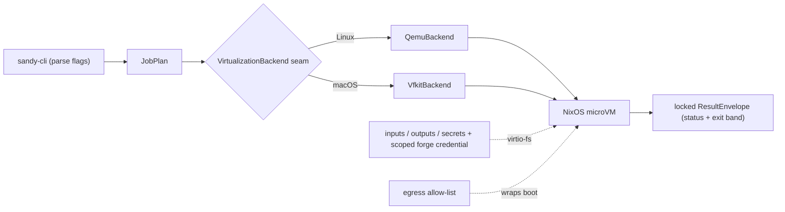

Source: [docs/overview.md#sandy-overview](../overview.md#sandy-overview)

## docs/architecture/overview.md

### The run pipeline

One `sandy run` is a straight-line pipeline.

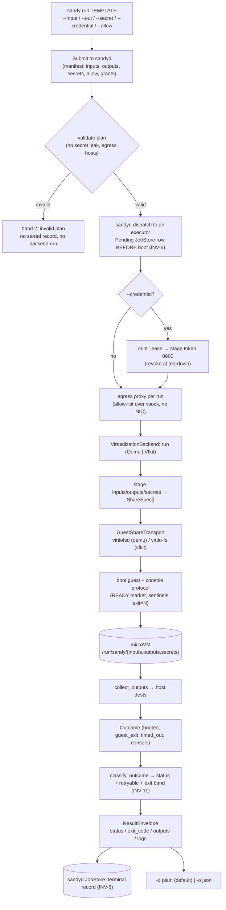

Source: [docs/architecture/overview.md#the-run-pipeline](../architecture/overview.md#the-run-pipeline)

### The seams

Every hard boundary is a trait with one implementation per target, so a subsystem can grow without widening the library's surface. These are the extension points.

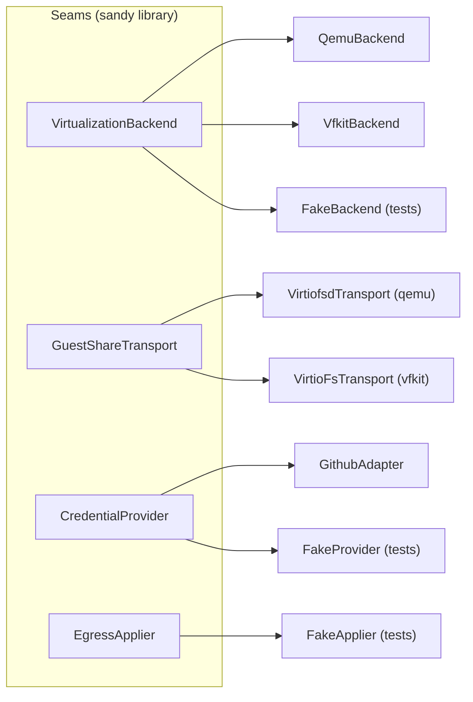

Source: [docs/architecture/overview.md#the-seams](../architecture/overview.md#the-seams)

### The control plane: sandyd, the host executor, interactive attach

The dispatch model `sandy run` itself now uses (the direct path was removed in #483): `sandy daemon submit`/`attach`/`status`/`cancel` goes through `sandyd` (the per-machine control-plane daemon) and, for M2 cross-machine dispatch, a remote `sandy-host-executor`. Full decision record: [`../decisions/sandyd.md`](../decisions/sandyd.md).

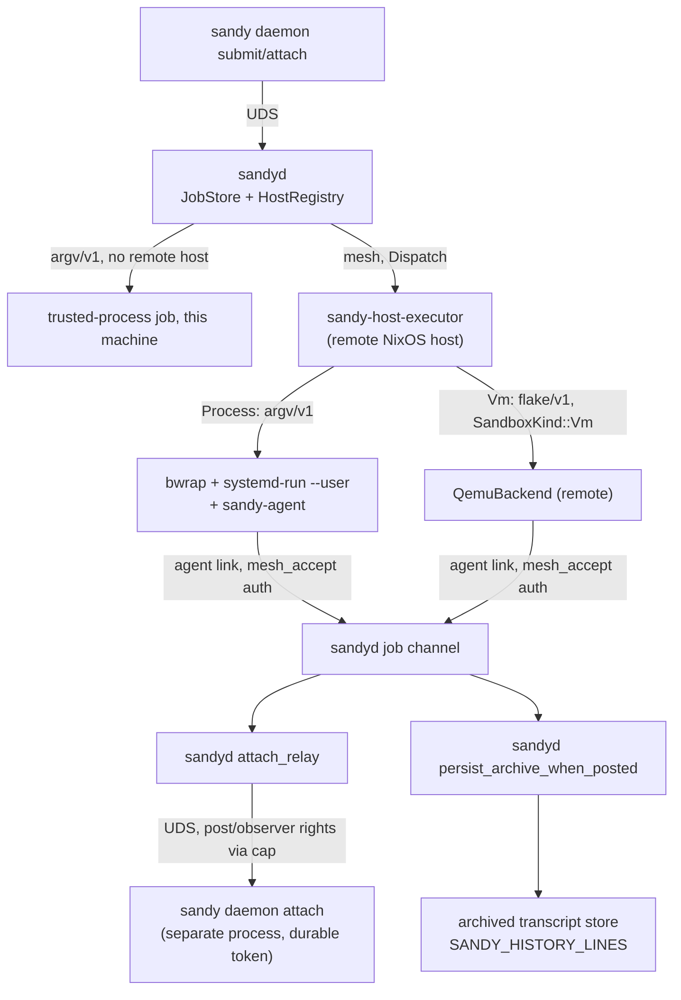

Source: [docs/architecture/overview.md#the-control-plane-sandyd-the-host-executor-interactive-attach](../architecture/overview.md#the-control-plane-sandyd-the-host-executor-interactive-attach)

## docs/architecture/components.md

### 1. The whole system

Reading it: a client talks only to `sandyd`. `sandyd` records and places the job; an executor runs it through `VirtualizationBackend` or the process sandbox; the guest has no network unless the run carries an allow-list, and then only through the per-run egress proxy; its agent link returns to `sandyd`. Sections 3 to 8 open each box.

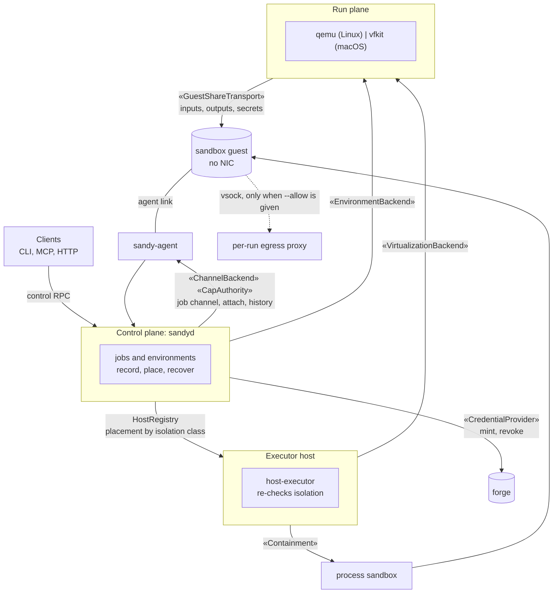

Source: [docs/architecture/components.md#1-the-whole-system](../architecture/components.md#1-the-whole-system)

### 3. Control plane: `sandyd`

One daemon per machine owns job state. The CLI and the broker are thin: they send control RPCs over a Unix socket (mode 0600, in a 0700 directory) and render the reply.

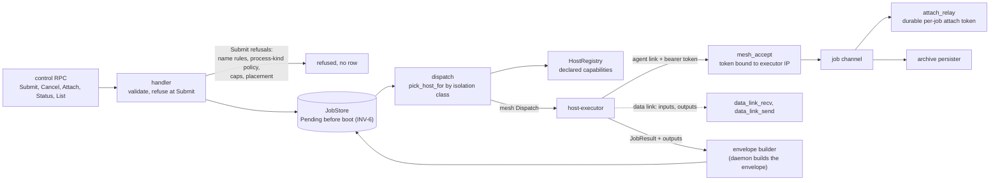

Source: [docs/architecture/components.md#3-control-plane-sandyd](../architecture/components.md#3-control-plane-sandyd)

### 3. Control plane: `sandyd`

One daemon per machine owns job state. The CLI and the broker are thin: they send control RPCs over a Unix socket (mode 0600, in a 0700 directory) and render the reply.

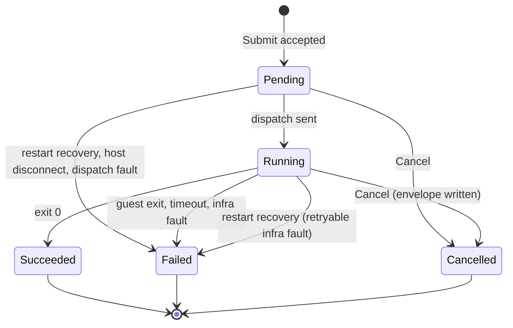

Source: [docs/architecture/components.md#3-control-plane-sandyd](../architecture/components.md#3-control-plane-sandyd)

### 4. Host executor

The executor trusts nothing it is sent. It re-checks the isolation class before it runs anything (defense in depth) and declares only what it can do. A host without containment refuses to start on Linux. The VM arm declares `Vm` only where a hypervisor exists (qemu on Linux, vfkit on macOS).

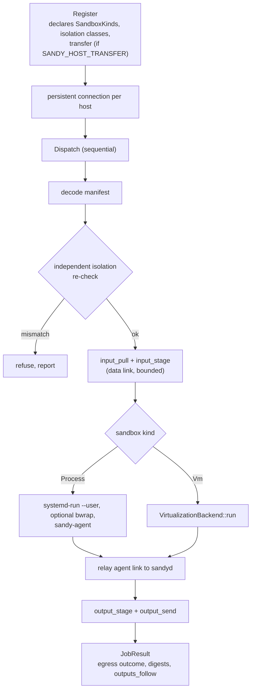

Source: [docs/architecture/components.md#4-host-executor](../architecture/components.md#4-host-executor)

### 5. Run plane: one VM boot

How it should behave:

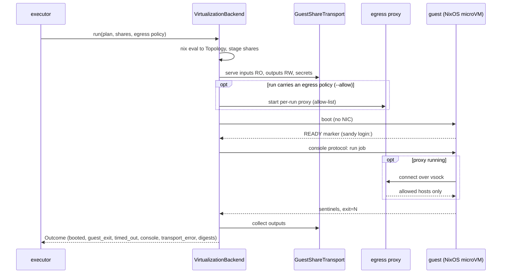

Source: [docs/architecture/components.md#5-run-plane-one-vm-boot](../architecture/components.md#5-run-plane-one-vm-boot)

### 6. Result and classification

The envelope is locked: its shape is the contract callers script against. A cancel writes an envelope too. The terminal record is written once, after redaction (#322).

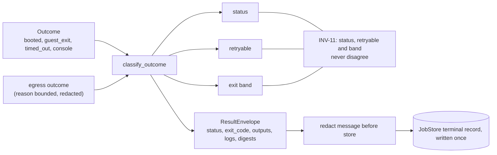

Source: [docs/architecture/components.md#6-result-and-classification](../architecture/components.md#6-result-and-classification)

### 7. Credentials

Fail-closed: a failed mint refuses the job (INV-7). A failed revoke keeps the record so the next start retries it. The token is never written to a log.

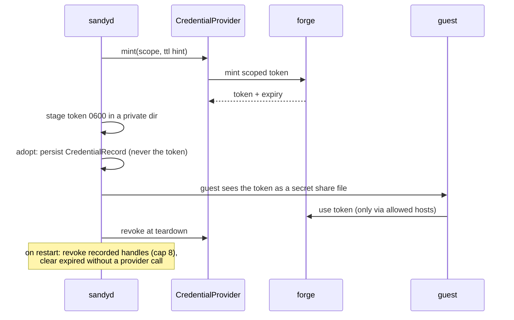

Source: [docs/architecture/components.md#7-credentials](../architecture/components.md#7-credentials)

### 8. Environments, broker and MCP

An environment is a long-lived service (for example a dev server) beside the job resource. The broker exposes both to HTTP clients and MCP tools.

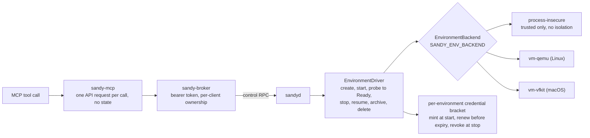

Source: [docs/architecture/components.md#8-environments-broker-and-mcp](../architecture/components.md#8-environments-broker-and-mcp)

## docs/architecture/spec.md

### 2. Guest shares (`GuestShareTransport`)

**Purpose.** Present host directories to the guest as virtio-fs mounts, the same `fsType = "virtiofs"` on both backends, for inputs (RO), outputs (RW), and the secret share (RO).

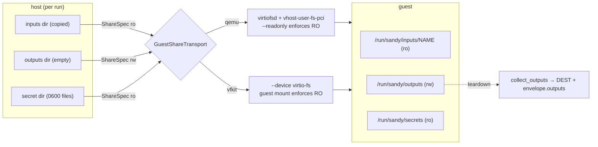

Source: [docs/architecture/spec.md#2-guest-shares-guestsharetransport](../architecture/spec.md#2-guest-shares-guestsharetransport)

### 4. Credential seam (`CredentialProvider`)

**Purpose.** Mint a short-lived, least-privilege forge token for a job, deliver it in-guest, and revoke it at teardown. Jobs get no mid-run refresh (#483).

```mermaid
sequenceDiagram
  participant S as sandyd
  participant P as CredentialProvider
  participant B as VirtualizationBackend
  participant G as guest
  S->>P: mint(scope, ttl)
  P-->>S: Minted(token, expiry, handle)
  S->>S: stage token 0600 in cred_dir (secret_dir)
  S->>B: run (plan + secret_dir)
  B->>G: boot; token exported as $GITHUB_TOKEN
  S->>P: revoke(lease) at teardown
```

Source: [docs/architecture/spec.md#4-credential-seam-credentialprovider](../architecture/spec.md#4-credential-seam-credentialprovider)

### 6. Result envelope + classification

**Purpose.** Turn a physical `Outcome` into the locked `ResultEnvelope` and a process exit band that agree (INV-11).

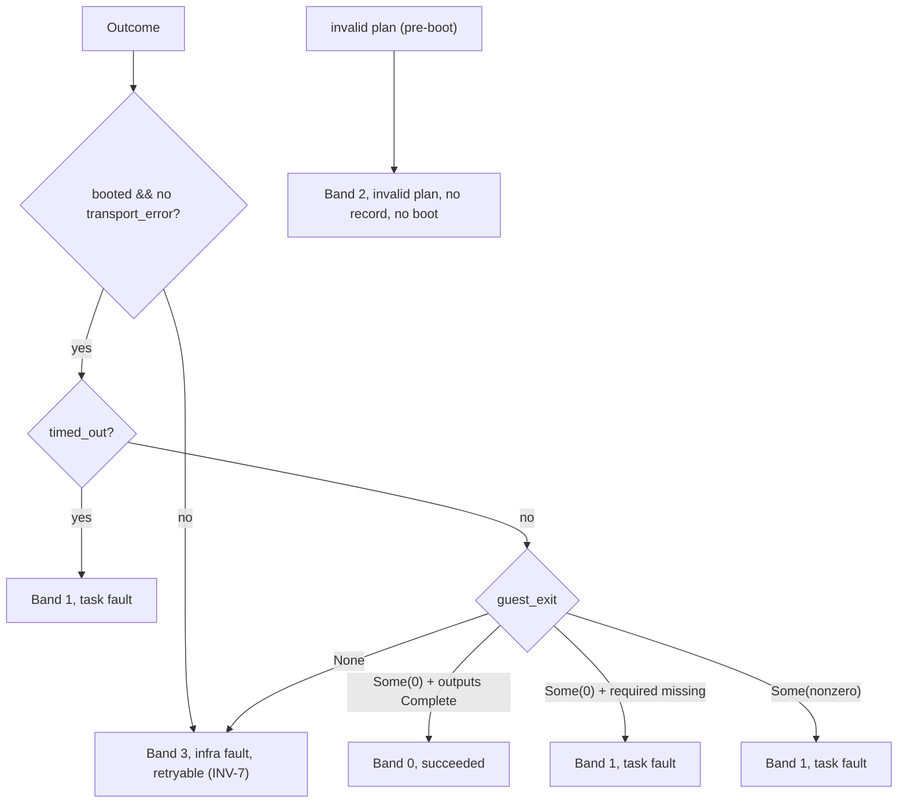

Source: [docs/architecture/spec.md#6-result-envelope--classification](../architecture/spec.md#6-result-envelope--classification)
