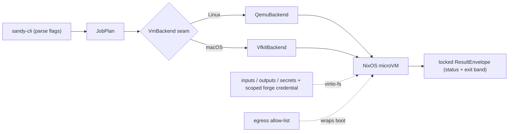

# sandy overview

sandy runs one job in an ephemeral NixOS microVM and returns a locked result envelope. It
owns the hypervisor launch natively (qemu on Linux, vfkit on macOS) behind one `VmBackend`
seam, delivers inputs/outputs/secrets and a scoped forge credential over virtio-fs shares,
enforces an egress allow-list around the boot, and classifies the outcome into a status + exit
band that never disagree.

This file is a pointer; the detailed docs already live under `docs/`:

- Orientation, the run pipeline, and the four seams →
  [`architecture/overview.md`](architecture/overview.md).
- Per-subsystem spec (decisions + KPI) → [`architecture/spec.md`](architecture/spec.md);
  live acceptance matrix → [`architecture/kpi.md`](architecture/kpi.md).
- Why it is built this way, one file per subsystem → [`decisions/`](decisions/).
- Credential-seam design and providers → [`design/`](design/), [`providers/`](providers/).

Build, test, and house rules are in the repo-root [`AGENTS.md`](../AGENTS.md).

## Agent fabric

A second, separate effort alongside the sandbox above: a serverless,
intermittency-tolerant medium for agents to communicate and run work across a
fleet of heterogeneous devices (epic
[#103](https://github.com/kauki-labs/sandy/issues/103)). Every seam — channel
backend, cap authority, minter, executor, placement, telemetry — ships a
trivial local impl first, proven against a shared contract-test harness,
before any VM, network, or P2P transport exists; a composition root then
selects one impl per seam (the all-local MVP, a local-VM profile, a remote
profile). `sandy-proto` carries the channel envelope; `sandy-fabric` is the
seam contracts and harness; `sandy-fabric-local` is the all-local profile's
trivial impls, one module per seam; `sandy-fabric-compose` is that profile's
composition root; `sandy-agent` is the sandbox agent as its own process, which
the process backend puts between itself and the job.

Block-by-block status lives on the epic's sub-issues, not here — a merged
block moves fast enough that a hand-maintained landed/open list in prose goes
stale within days. Check #103 for which blocks are merged.

Design: [`design/agent-fabric/spec.md`](design/agent-fabric/spec.md). Decisions:
[`decisions/agent-fabric.md`](decisions/agent-fabric.md).

## Control plane

A third effort, built on the fabric above: `sandyd`, a per-machine daemon that
dispatches jobs into the agent fabric over a control RPC surface (epic
[#205](https://github.com/kauki-labs/sandy/issues/205)). `sandy-control-proto`
defines the RPC contract (Submit/Cancel/Attach/Status/List); `sandy-conn` is the
stream transport it rides (UDS locally, vsock into a VM guest, mesh across
machines); `sandy-orchestrator` is the dispatch core (job manifest,
submitter-bounded capability derivation).

As above, check epic #205 for which blocks are merged. Decisions:
[`decisions/sandyd.md`](decisions/sandyd.md).

### Milestone 2 — cross-machine dispatch

M2 runs a sandboxed job on a different machine than the one that submitted it.
The macOS orchestrator (`sandyd`) places a job on a registered remote NixOS host
(the remote host) when an agent-link listener address is configured and
`HostRegistry::pick_host_for` finds a host whose declared backends satisfy the
job's required isolation class; absent either, the job runs locally instead. A
placed job runs in a `bwrap` sandbox under `systemd-run --user` with
`sandy-agent` inside, and links the agent back to the orchestrator over the
mesh. Stage 1 is **trusted-process** only; untrusted/VM isolation is a later
backend (see #269's design and `decisions/sandyd.md`).

The flow and the crates it added:

- **`sandy-executor-proto`** — the orchestrator↔host-executor contract:
  `Register`/`Registered`/`RegisterRefused`, `Dispatch`, `Capabilities`,
  `IsolationClass`, and the agent-link prefix encode/decode.
- **`sandyd`** — the control plane (`submit`/`status`/`list`/`cancel`/`attach`
  over the UDS), the `HostRegistry`, the mesh listener, `pick_host_for`
  placement by isolation class, the decision-6 agent-link accept loop, and the
  dispatch relay.
- **`sandy-host-executor`** — dials the orchestrator, probes its containment,
  `Register`s, then handles each `Dispatch` sequentially: decode the argv/v1
  manifest, **re-check the isolation class independently** (defense in depth),
  launch via `ProcessBackend`, and relay the agent link back.
- **`sandy-agent`** + **`impls/local`** (`SystemdRunContainment`,
  `ProcessBackend`) run and contain the job on the host.
- Nix overlays plus a hardened `services.sandy-executor` nixosModule deploy the
  executor onto a user-specified base.

### Known gaps and operations

- **Result observability (open).** A completed job still reads
  `JOB_STATUS_PENDING` in the orchestrator — the exit code and output do not
  propagate back yet (#292, item 5). A separate change wires this through; until
  it lands, treat orchestrator job status as dispatch state, not job result.
- **Watching the deployed executor.** Its own logs land in the **user** journal,
  not the system unit: tail `journalctl _UID=992 -f`, not
  `journalctl -u sandy-executor`. `PAMName=login` puts the process in the user
  session scope that owns the `systemd-run --user` scopes, so the unit's own
  journal stays empty.
