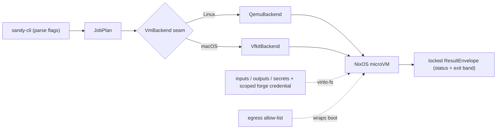

# sandy overview

sandy runs one job in an ephemeral NixOS microVM and returns a locked result envelope. It
owns the hypervisor launch natively (qemu on Linux, vfkit on macOS) behind one `VmBackend`
seam, delivers inputs/outputs/secrets and a scoped forge credential over virtio-fs shares,
enforces an egress allow-list around the boot, and classifies the outcome into a status + exit
band that never disagree.

This file is a pointer; the detailed docs already live under `docs/`:

- Orientation, the run pipeline, and the four seams →
  [`architecture/overview.md`](architecture/overview.md).
- Per-subsystem spec (decisions + KPI) → [`architecture/spec.md`](architecture/spec.md);
  live acceptance matrix → [`architecture/kpi.md`](architecture/kpi.md).
- Why it is built this way, one file per subsystem → [`decisions/`](decisions/).
- Credential-seam design and providers → [`design/`](design/), [`providers/`](providers/).

Build, test, and house rules are in the repo-root [`AGENTS.md`](../AGENTS.md).

## Agent fabric (in progress)

A second, separate effort alongside the sandbox above: a serverless,
intermittency-tolerant medium for agents to communicate and run work across a
fleet of heterogeneous devices (epic #103). Every seam ships a trivial local
impl first, proven against a shared contract-test harness, before any VM,
network, or P2P transport exists. Landed so far: the channel envelope codec
(`sandy-proto`), the seam contracts + harness (`sandy-fabric`), and three
trivial local impls in `sandy-fabric-local` — the in-memory `ChannelBackend`,
the HMAC-SHA256 `LocalCapAuthority`, and all-local placement (static registry +
direct probe + lease soft-state). Still open: the `Channel` abstraction, the
`Executor` adapter, the sandbox agent, and the composition root that wires the
all-local MVP end to end.

Design: [`design/agent-fabric/spec.md`](design/agent-fabric/spec.md). Decisions:
[`decisions/agent-fabric.md`](decisions/agent-fabric.md).
