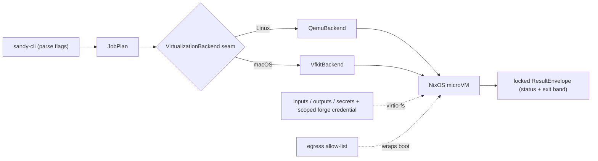

# sandy overview

sandy runs one job in an ephemeral NixOS microVM and returns a locked result envelope. It
owns the hypervisor launch natively (qemu on Linux, vfkit on macOS) behind one `VirtualizationBackend`
seam, delivers inputs/outputs/secrets and a scoped forge credential over virtio-fs shares,
enforces an egress allow-list around the boot, and classifies the outcome into a status + exit
band that never disagree.

This file is a pointer; the detailed docs already live under `docs/`:

- Orientation, the run pipeline, and the four seams →
  [`architecture/overview.md`](architecture/overview.md).
- Per-subsystem spec (decisions + KPI) → [`architecture/spec.md`](architecture/spec.md);
  live acceptance matrix → [`architecture/kpi.md`](architecture/kpi.md).
- Why it is built this way, one file per subsystem → [`decisions/`](decisions/).
- Credential-seam design and providers → [`design/`](design/), [`providers/`](providers/).

Build, test, and house rules are in the repo-root [`AGENTS.md`](../AGENTS.md).

## Agent fabric

A second, separate effort alongside the sandbox above: a serverless,
intermittency-tolerant medium for agents to communicate and run work across a
fleet of heterogeneous devices (epic
[#103](https://github.com/kauki-labs/sandy/issues/103)). Every seam — channel
backend, cap authority, minter, executor, placement, telemetry — ships a
trivial local impl first, proven against a shared contract-test harness,
before any VM, network, or P2P transport exists; a composition root then
selects one impl per seam (the all-local MVP, a local-VM profile, a remote
profile). `sandy-proto` carries the channel envelope; `sandy-fabric` is the
seam contracts and harness; `sandy-fabric-local` is the all-local profile's
trivial impls, one module per seam; `sandy-fabric-compose` is that profile's
composition root; `sandy-agent` is the sandbox agent as its own process, which
the process backend puts between itself and the job.

Block-by-block status lives on the epic's sub-issues, not here — a merged
block moves fast enough that a hand-maintained landed/open list in prose goes
stale within days. Check #103 for which blocks are merged.

Design: [`design/agent-fabric/spec.md`](design/agent-fabric/spec.md). Decisions:
[`decisions/agent-fabric.md`](decisions/agent-fabric.md).

## Control plane

A third effort, built on the fabric above: `sandyd`, a per-machine daemon that
dispatches jobs into the agent fabric over a control RPC surface (epic
[#205](https://github.com/kauki-labs/sandy/issues/205)). `sandy-control-proto`
defines the RPC contract (Submit/Cancel/Attach/Status/List); `sandy-conn` is the
stream transport it rides (UDS locally, vsock into a VM guest, mesh across
machines); `sandy-orchestrator` is the dispatch core (job manifest,
submitter-bounded capability derivation).

As above, check epic #205 for which blocks are merged. Decisions:
[`decisions/sandyd.md`](decisions/sandyd.md).

### Milestone 2 — cross-machine dispatch

M2 runs a sandboxed job on a different machine than the one that submitted it.
The macOS orchestrator (`sandyd`) places a job on a registered remote NixOS host
(the remote host) when an agent-link listener address is configured and
`HostRegistry::pick_host_for` finds a host whose declared backends satisfy the
job's required isolation class. For an `argv/v1` (trusted-process) submission,
absent either condition the `Submit` is refused with a named reason and no
row is written (#868), not a local fallback; a placed
trusted-process job runs in a `bwrap` sandbox under `systemd-run --user` with
`sandy-agent` inside, and links the agent back to the orchestrator over the
mesh.
Untrusted-job isolation stays VM-only, never the process backend, on any host
(`decisions/process-containment.md` decision 6, #150).

A placed job can also be a VM job: `sandy daemon submit --flake <ref>` dispatches
a `flake/v1` manifest to a host that declares `SandboxKind::Vm` (#332), and the
host-executor boots it there via `QemuBackend`, the same guest-boot path `sandy
run --flake` uses locally. `Capabilities` is a SET of declared sandbox kinds
per host-executor process, so one host can serve both `Process` and `Vm`
dispatches at once. Like `argv/v1`, a `flake/v1` submission has no local
fallback: if no remote is configured or no registered host declares `Vm`, it
is refused outright at `Submit` time (named reason, no silent hang), never
left silently `Pending`. The code path is built and host-executor-side
tested; as an operational matter the standing `sandy-host-executor` deployed
on the current remote test host has not yet been redeployed with #332's
VM-capability detection, so it still registers `Process` only, and a
`flake/v1` submit against it is refused for that reason today.

The flow and the crates it added:

- **`sandy-executor-proto`** — the orchestrator↔host-executor contract:
  `Register`/`Registered`/`RegisterRefused`, `Dispatch`, `Capabilities`,
  `IsolationClass`, and the agent-link prefix encode/decode.
- **`sandyd`** — the control plane (`submit`/`status`/`list`/`cancel`/`attach`
  over the UDS), the `HostRegistry`, the mesh listener, `pick_host_for`
  placement by isolation class, the decision-6 agent-link accept loop, and the
  dispatch relay.
- **`sandy-host-executor`** — dials the orchestrator, probes its containment
  and VM capability, `Register`s, then handles each `Dispatch` sequentially:
  **re-check the isolation class independently** (defense in depth), decode
  the `argv/v1` manifest and launch via `ProcessBackend`, or the `flake/v1`
  manifest and launch via `QemuBackend`, and relay the agent link back.
- **`sandy-agent`** + **`impls/local`** (`SystemdRunContainment`,
  `ProcessBackend`) run and contain the job on the host.
- Nix overlays plus a hardened `services.sandy-executor` nixosModule deploy the
  executor onto a user-specified base.

### Interactive attach (#340)

`sandy daemon submit` then `sandy daemon attach` behaves like SSH into a
`tmux` session: a real PTY exists from the moment the job starts
(`impls/agent/src/tmux_pty.rs`, built for the trusted-process backend and
wired through for VM jobs too, though no live gate yet proves the VM leg end
to end — see `kpi.md`'s KA3), the detach key is SSH's own `~.` sequence
(recognized only right after a newline, so it rarely collides with real
input), and a durable per-job attach token lets a genuinely separate
`attach` process reattach later with post rights, not just a fresh
session's own observer rights. `attach -o json` writes an NDJSON stream for
agent callers: an `attached` line first (with the cap), `output` lines
(base64), and an `exit` line last (#513). Detaching does not end the job: `sandyd`'s
`attach_relay` (`crates/sandyd/src/attach_relay.rs`) keeps relaying the live
process over the job's own channel, and, for process-backed jobs, a detached
job's deadline falls back to a shorter grace period rather than running
unlimited forever once nobody is attached. VM-backed jobs honor live attach
state too (#366; see `kpi.md`'s note on #185/#340), the same way
process-backed ones do.

Landed on `main` (#378): the archived-transcript path. A job's stdin/stdout
for its whole lifetime, bounded by `SANDY_HISTORY_LINES` (default 10,000,
configurable per job), is captured and persisted by `sandyd` the moment the
agent posts it, regardless of whether anyone is attached at the time
(`persist_archive_when_posted`). The next client that attaches, live or
after the job has already finished, receives it as an archive frame
(`attach.rs::write_archive`) — usable even if nobody ever attached live or
the job and its VM are long gone.

**Resolved (#366, related #185).** `RunControl`'s live deadline
suspension/extension — the mechanism "unlimited while attached" needs — is
now honored by both backends: the process backend's own poll loop, and the
VM backends' (qemu/vfkit) console driver, which re-checks the live
deadline/cancellation on every ~250ms poll tick instead of enforcing a
static timeout computed once at job start. `daemon cancel` now ends an
in-flight VM job the same way it already ended a process-backed one. See
`decisions/sandyd.md` decision 14's amendment for the full record.

### Known gaps and operations

- **Watching the deployed executor.** Its own logs land in the **user** journal,
  not the system unit: tail `journalctl _UID=992 -f`, not
  `journalctl -u sandy-executor`. `PAMName=login` puts the process in the user
  session scope that owns the `systemd-run --user` scopes, so the unit's own
  journal stays empty.
