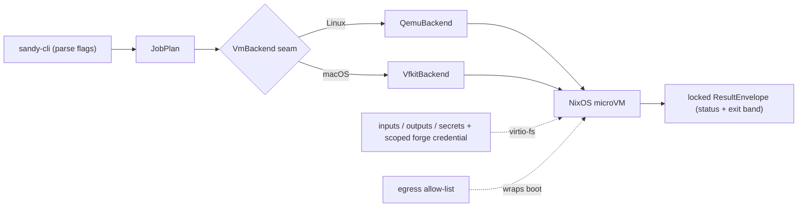

# sandy overview

sandy runs one job in an ephemeral NixOS microVM and returns a locked result envelope. It
owns the hypervisor launch natively (qemu on Linux, vfkit on macOS) behind one `VmBackend`
seam, delivers inputs/outputs/secrets and a scoped forge credential over virtio-fs shares,
enforces an egress allow-list around the boot, and classifies the outcome into a status + exit
band that never disagree.

This file is a pointer; the detailed docs already live under `docs/`:

- Orientation, the run pipeline, and the four seams →
  [`architecture/overview.md`](architecture/overview.md).
- Per-subsystem spec (decisions + KPI) → [`architecture/spec.md`](architecture/spec.md);
  live acceptance matrix → [`architecture/kpi.md`](architecture/kpi.md).
- Why it is built this way, one file per subsystem → [`decisions/`](decisions/).
- Credential-seam design and providers → [`design/`](design/), [`providers/`](providers/).

Build, test, and house rules are in the repo-root [`AGENTS.md`](../AGENTS.md).

## Agent fabric

A second, separate effort alongside the sandbox above: a serverless,
intermittency-tolerant medium for agents to communicate and run work across a
fleet of heterogeneous devices (epic
[#103](https://github.com/kauki-labs/sandy/issues/103)). Every seam — channel
backend, cap authority, minter, executor, placement, telemetry — ships a
trivial local impl first, proven against a shared contract-test harness,
before any VM, network, or P2P transport exists; a composition root then
selects one impl per seam (the all-local MVP, a local-VM profile, a remote
profile). `sandy-proto` carries the channel envelope; `sandy-fabric` is the
seam contracts and harness; `sandy-fabric-local` is the all-local profile's
trivial impls, one module per seam; `sandy-agent` is the sandbox agent as its own
process, which the process backend puts between itself and the job.

Block-by-block status lives on the epic's sub-issues, not here — a merged
block moves fast enough that a hand-maintained landed/open list in prose goes
stale within days. Check #103 for which blocks are merged.

Design: [`design/agent-fabric/spec.md`](design/agent-fabric/spec.md). Decisions:
[`decisions/agent-fabric.md`](decisions/agent-fabric.md).
